# 干活蜂群 · 平台使用说明（用户版）

- **版本**：v1.5.0
- **访问地址**：https://swarm.example.com
- **适用对象**：一人公司（OPC）老板——你一个人，带着一支 AI 团队干活
- **配套文档**：《蜂群管理使用说明》（平台管理员版，普通用户无需阅读）

---

## 1. 这是什么

干活蜂群是一支住在服务器上的 **AI 团队**：你注册账号、开一家「公司」，系统按你选的行业模板给你配好小组和数字员工；你只管发任务（下单），他们领取、执行、互相审核，最后把成果交到你手里，并把每一笔花费记在明账上。你是老板：定标准、看进度、审成果、拍板裁决。

平台本身不限行业，**首发行业包是「短剧公司」**：选它开公司，会一次装好短剧文案组、选题调研组、审片组三支队伍，附带 6 个官方技能（爆款标题生成、剧本卖点提炼、分集钩子、封面文案、评论区话术、多语言简介）和一批示例知识，开局就能干活。不选行业包也可以，那就从一个通用小组白手起家。你还可以从**人才库**里一键招募现成的 AI 员工人设（来自开源社区的智能体合集，经平台管理员审核后上架），招进来就是你自己的普通成员，可改可删。

**v1.5.0 的主要变化**（细节见对应章节）：知识库、技能库、人才库有了一个统一入口「**资源中心**」（第 9 章）；知识库补上了**平台公共知识**分组，并多了「**搜索测试**」工具（第 13 章）；人才库改为按月自动更新，多了**热度榜**和「**本月上新**」（第 11 章）；管理员可以直接把好技能**下发**到你的空间（第 10 章），也能通过**平台公告**和**消息线程**直接联系你（第 16 章）；办公室实况栏多了「**待你处理**」汇总（第 4 章）。

一句实话先说在前面：**AI 干活烧的是你自己的大模型 API**。你需要在公司里填一条自己的 API（并充值记账），或者使用平台发放的体验额度。平台不卖额度、不经手你的钱。

**本说明与现状的对应关系，先说清三件「还没做」的事**（后文相关章节会再标注）：

- **邮件发送尚未开通**：晨报、签到提醒、公告、管理员消息等目前只有**站内版**。邮件的接入点已经在系统里留好，发信邮箱（SMTP）配置到位后自动启用，不需要你做任何事；在那之前，设置页里邮件通道会如实显示「未接入」。
- **任务模板不能上架分享**：发单模板目前只有官方种子和你自己的个人模板两个来源，没有「提交上架给别人用」的通道（技能和公司风格模板则有完整的上架审核通道）。
- **成员人设不支持 AI 生成**：注册问卷帮你组建默认团队时，用的是规则模板拼装人设，不调用大模型；成员的专属提示词要么来自模板，要么由你手工编辑。

---

## 2. 快速开始（照着做，10 分钟跑通第一单）

### 第 1 步：注册并登录

打开 https://swarm.example.com ，点注册，填邮箱、密码和显示名。绝大多数情况下注册完就能直接登录使用；个别注册会因为风控原因进入「待审核」，页面会有提示，等平台管理员开通即可（审核只针对异常注册）。

管理员发给你的账号如果带临时密码，首次登录会强制你先改密码，改完才能进系统。

### 第 2 步：跟着向导开公司（五步，可全程跳过）

点「开新公司」会进入一个**五步向导**：公司信息 → 接入你的 AI → 关于你 → 提醒与督促 → 确认。每一步都可以跳过，跳过后的效果与旧版「只填公司名开公司」完全一样，不用担心漏填。

最值得认真填的是第二步「**接入你的 AI**」——把 API 配置从「开公司之后再说」提前到了注册当场：

- 选服务商预设（预置 DeepSeek / OpenAI / Anthropic / 通义 / 智谱等，也可填自定义兼容地址），Base URL 和默认模型会**自动带出**，可改；
- 你只需要粘贴**一个 API Key**；
- 点「测试连接」，当场真连一次厂商验证能不能通（不记账、不扣余额）；没测通或者暂时没 Key 也没关系，**可以跳过**，用平台体验额度先试跑（见第 3 步）。

确认提交后，这条 API 会存进你的空间并设为**默认 API**，Key 加密保存、页面只回掩码，和在设置里手工新增是同一条路径、同一个效果。

其余步骤的作用：

- **关于你**：选行业、你的工作、想用蜂群做什么、想解决什么问题。
- **提醒与督促**：设晨报时间和签到提醒时间、要不要每天提醒你签到，并可以写下「需要总经理督促你的事项」（如「每天检查剧本进度」）——这些答案会直接写进晨报/签到设置，督促事项会在每天的晨报里原样回显（见第 15 章）。
- **确认**：系统按「行业包底子 × 你的答案」用规则模板**拼出一支默认团队**（小组 + 成员 + 人设），生成的是普通小组和普通成员，建好之后随便改、随便删。已经有团队的老空间不会被自动重组。

向导答案之后可以在「设置后台 → 我的问卷」里查看和修改：提醒类答案改了即时生效；行业/工作类只是存档参考；修改问卷不会碰你的 API 配置，更不会重组已有团队。

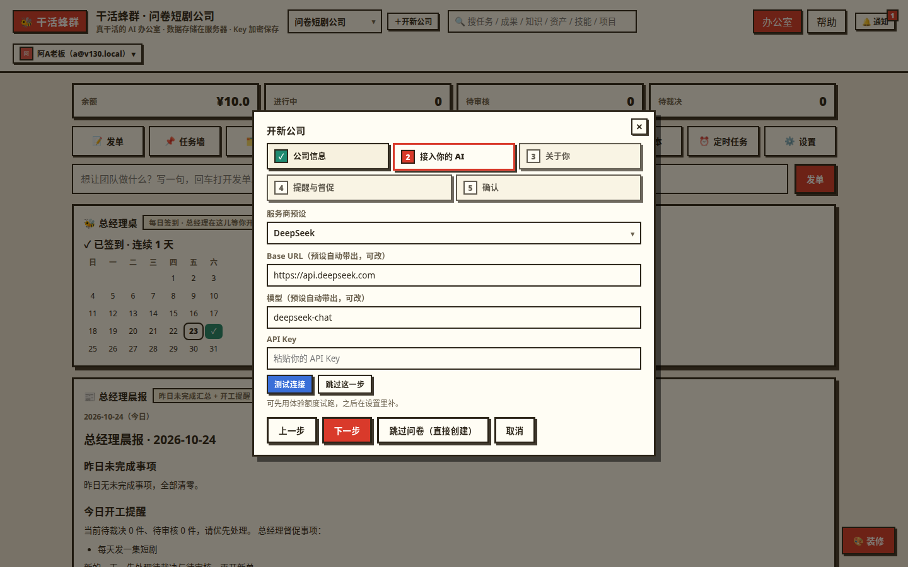

### 第 3 步：让团队能开工（二选一）

AI 员工干活前必须满足「有 API 可用 + 有余额」，两条路任选其一：

- **用体验额度（最快，适合先试跑）**：如果平台管理员给你的空间发过体验额度，你什么都不用配，直接去发单。体验额度由管理员在管理台发放，你自己领不了；小额、每个空间只能领一次，用完就停。
- **填自己的 API Key（长期正道）**：向导第二步填过就已经好了；没填的，到「设置后台 → API 配置」新增一条 API，保存后点「**测试连接**」确认能通，再到「成本中心」给这条 API **采购充值**（登记可用额度，见第 14 章），余额大于 0 才能开工。

Key 只加密保存在服务器上，任何页面都只显示掩码，不会明文出现。

### 第 4 步：跟着五步引导发第一单

办公室顶部有一张**新手五步引导卡**：① 认识团队 → ② 让团队能开工 → ③ 发第一单 → ④ 看任务时间线 → ⑤ 审核并收第一份成果。它不是摆设：每一步都和你的真实行为联动打勾（比如空间里任一 API 余额大于 0、有任务、已有已完成任务，都会自动判定完成）；手动步点卡上的按钮就能推进。新空间默认展开，不想看可跳过隐藏；之后想再打开，在帮助页或设置页可以重置重开。

点第三步，用一个官方技能一键试跑（比如选「爆款标题生成」，把参数填上提交），或者点办公室顶部的快速发单条直接写一条任务发出去。

### 第 5 步：收第一份成果

任务被领取执行、经审核通过后会变成「已完成」，成果出现在办公室的交付台和「成果库」弹窗里。点开能看全文、看这一单注入了哪些知识、花了多少钱。到这里，第一圈就跑通了。

---

## 3. 核心概念速览

- **空间（公司）**：你的公司就是一个空间。小组、成员、API、账本、知识库、成果全都装在空间里，空间之间数据完全隔离、互不可见。一个账号可以拥有多个空间（开多家公司），在顶栏切换。
- **小组**：按职能分的团队，如文案组、调研组。可以给小组指定用哪条 API，不指定就用公司默认 API。
- **成员与工种**：成员是 AI 数字员工，不是真人。每个成员有一个**工种**（如文案、研究员、程序员），决定他能接哪类任务；还有一段**专属提示词**（人设和干活要求）。成员还可以**单独绑定一条 API（驱动模型）**、**定制像素形象**（肤色、衬衫、发色、发型），见第 12 章。工种里有两个特殊岗位：**组长**负责把大方案拆成子任务，**审核**负责按标准把关成果。工种和任务类型都可以在设置里自定义增减，不是写死的。
- **任务与子任务**：你发的每一单就是一个任务。「方案下发」会生成一个**项目**，由组长把方案拆成若干子任务依次推进；子任务也是任务，在任务墙上都能看到。
- **审核与裁决**：成果产出后先过审核成员这一关，按你在设置里定的**审核标准**逐条核对；不过关会被打回重做。打回满次或花钱超预算的任务会停成「待裁决」，等你这个老板亲自拍板——这叫裁决。
- **任务模板**：发单的预填样板（标题/类型/说明），有官方通用模板、行业模板和你的个人模板三级；套用只是把表单填好，不会直接发单（见 6.1）。任务模板目前不能上架分享。
- **资产**：整份的、结构化的资料，如一整部按集分段的剧本、一份甲方 brief 原件。发任务时可以引用资产的某几集/某几段作为上下文，引用时会锁定当时的版本，以后资产改了新版，老任务用的还是旧版，可追溯。
- **知识库**：碎片化的条目——方法、标准、经验、片段，分平台 / 公司 / 小组 / 成员四档（见第 13 章）。任务执行时系统会自动挑相关的知识条目喂给 AI（叫「注入」），任务详情里能查这一单到底注入了哪几条。
- **技能（Skill）**：可复用的「岗位作业包」：一套带填空参数的作业模板 + 适用工种 + 绑定的知识范围 + 输出规格。装上技能，填几个参数就能一键发单，产出标准稳定。没有参数的技能，本质上就是个模板。
- **资源中心**：知识库、技能库、人才库三个库的统一入口（v1.5.0 新增，见第 9 章）——一个地方看三库总览、按统一卡片挑选，再进对应库引用 / 安装 / 招募。
- **智能体模板与人才库**：从 GitHub 开源合集同步来的 AI 员工人设模板，管理员审核后进**人才库**；你选一个模板招募，就在你的小组里生成一位带完整人设的普通成员（见第 11 章）。
- **公司风格**：你办公室的装修——配色、地板、家具、海报和招牌。可以存成**风格模板**自己用，也可以提交上架给全平台套用（见第 5 章）。
- **晨报与签到**：总经理每天按你设的时间生成一份晨报（昨日未完成 + 今日开工提醒 + 热点新闻）；签到是你的每日打卡，攒连续天数（见第 15 章）。
- **平台公告与管理员消息**：平台管理员可以直接联系到你的通道——公告发在办公室首页，重要事项还会通过消息线程单独发给你，你能直接回复（见第 16 章）。
- **成本账本**：每一次 AI 调用都记一笔账（哪个任务、谁干的、用的哪条 API、花了多少）。账本只增不改，余额由「采购总额 − 账本消耗」算出来，所以永远对得上账。系统内部用「厘」作最小单位记账（1 元 = 1000 厘）保证分毫不差，你在界面上看到的都是正常的元。

---

## 4. 办公室（实况中枢）

办公室是你的主页面，也是登录后的**唯一主场景**：所有功能都从办公室打开，不再有互相跳转的独立页面。

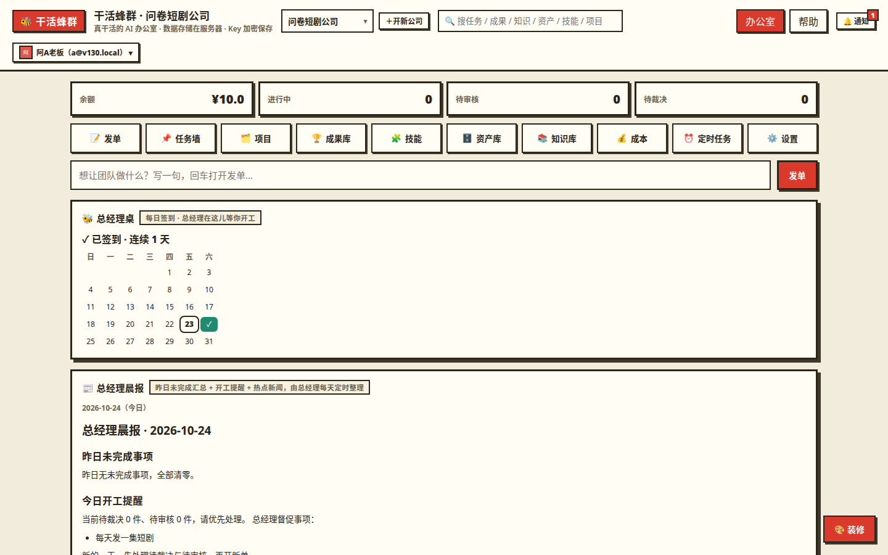

**这是什么**：一间像素风办公室，里面的每个像素小人就是你的一位 AI 成员。办公室上方有实况状态栏和功能坞，下方是办公室本体：小人按工种穿不同颜色的衣服，审核员们统一坐在「审核桌」旁；办公室里还有任务墙（进行中的任务会贴成彩色便签）、交付台（已完成的任务在那里堆成包裹）、组长和你的老板办公室、总经理桌（签到与晨报入口，见第 15 章）。

**顶部实况栏**：一眼看全公司的实时数字——当前余额、进行中任务数、待审核数、待裁决数，全部取自真实数据。点对应数字会直接打开相应的功能弹窗。

**「待你处理」（v1.5.0 新增）**：实况栏把等你拍板的事汇成一个聚合入口——待审核 + 待裁决的总数。点它直达任务墙处理，不用挨个弹窗翻找还有什么在等你。

**平台公告区（v1.5.0 新增）**：办公室首页有一块公告区，平台管理员发布的公告会显示在这里（见 16.1）。只显示与你有关的（发给全部空间的、或点名发给你这个空间的）且正在发布中的公告，管理员撤下的会立即消失。

**功能坞与弹窗**：办公室顶部有一排功能入口（任务墙、项目、成果库、资源中心、技能、人才库、资产、知识库、成本、定时任务、设置、装修等）。点任意一个，功能会以**大弹窗**打开——桌面端接近全屏，移动端是全屏面板；按 Esc、点遮罩、点关闭钮，三种方式都能关。弹窗打开时地址栏会出现对应的深链（如 `#/tasks`、`#/skills`、`#/talents`、`#/kb`），把链接发给自己或刷新页面都能直达同一个弹窗。只有这几处保持独立页面：登录/注册、平台管理台、帮助、账号设置、公开交付页与参观页。

**顶部快速发单条**：实况栏旁常驻一条发单输入，写一句任务回车，就直达发单弹窗并预填好，再补小组、类型即可发出。

**你什么时候用办公室**：每天打开平台的第一眼——看谁在忙、谁在待命、墙上还压着多少活、账上还剩多少钱、平台有没有新公告。

**怎么用**：

- **看状态**：小人头顶有状态气泡——「💻 执行中」在干活（小人会轻轻起伏）、「📋 审核中」在审别人的成果、「📋 待命审核」是空闲的审核员、「💤 待命」是暂时没活（有轻微的呼吸浮动）。状态全部由真实任务驱动，没有任务时全员待命，不会假装忙碌。
- **点小人**：点任意小人以弹窗打开他的档案（深链 `#/member/<成员id>`），可以改名字、换工种、换小组、编辑专属提示词，还可以给他单独绑模型、定制形象（见第 12 章）。
- **缩放与小地图**：办公室右上角有放大/缩小/全景按钮，也能滚轮缩放、拖动画布；小地图点一下就跳到对应区域。队伍变大、办公室变长时很好用。
- **审核桌上的牌子**：写着「审核标准 N 条」，就是你当前生效的审核标准条数。
- **手机上看**：手机端画布下方有一条状态摘要（进行中 / 待审核 / 待裁决各几件），点一下就打开任务墙弹窗。

---

## 5. 公司风格定制（装修你的办公室）

**这是什么**：办公室的长相——配色、地板、家具、墙上的海报、门口的招牌——都可以按你的公司品味换，而且所有定制**只动办公室这张画布**，不影响任何功能和数据。同事（成员小人）的形象定制是另一回事，在第 12 章。

**入口**：办公室功能坞里的「装修」（风格面板）。

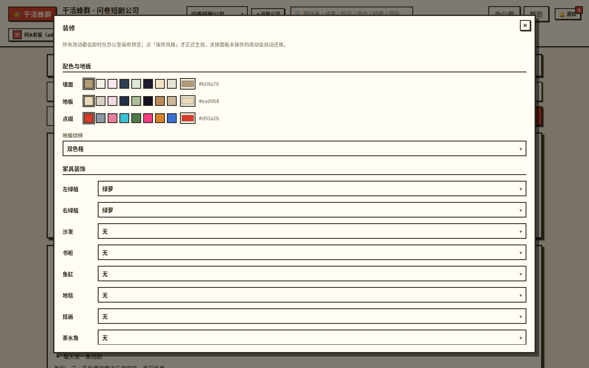

### 5.1 能改什么

- **配色**：墙面色、地板色、点缀色三处，配色只作用于办公室场景。
- **地板纹样**：素面、木纹、瓷砖、棋盘格四种。默认是棋盘格。
- **像素家具**：家具目录按**预设锚点槽位**摆放——左右绿植、沙发、书架、鱼缸、地毯、挂画、咖啡、猫，共九个槽位，每个槽位选款式或关掉。槽位是定点摆放（为了避开工位和走道），不能自由拖拽。默认只有左右两盆绿植。
- **上传图片**：可以上传你自己的图片，挂在墙上作**海报**，或挂在门口作**公司招牌**。图片只在你自己空间的办公室里使用。
- **一键生成搭配**：拿不准怎么配，点它，系统从站内预设里随机组合出一套和谐搭配（配色 + 纹样 + 家具）。如实说明：这是**预设组合的随机搭配，不接 AI 生图**，不喜欢就再点一次换一套，或在此基础上手工微调。

默认风格（什么都不改时）和旧版办公室长得一模一样，定制是纯增量。

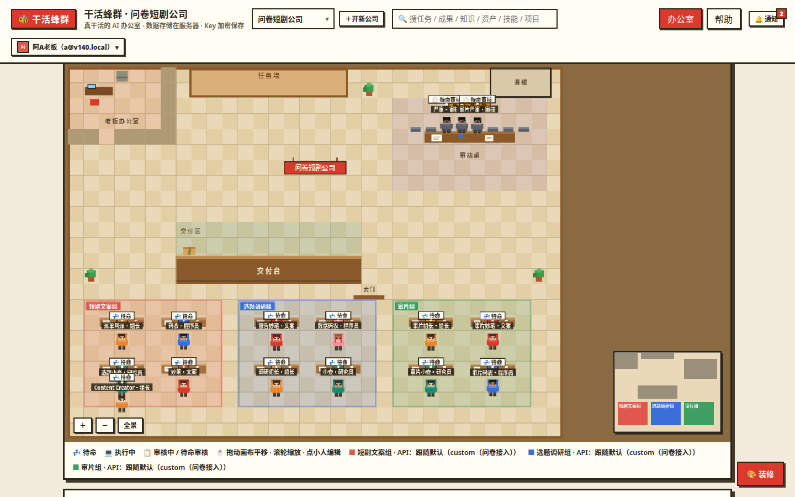

### 5.2 风格模板：存、享、套用

调满意的一套装修可以存成**风格模板**反复用、跨时套用。模板分三级：

1. **私有**：只有你自己能用。
2. **本空间共享**：存进本空间供复用。
3. **提交上架**：提交后进入平台管理员审核——审核不只看配色，还会看你模板里**上传图片的内容**；驳回必须写明原因。**未过审模板的图片不会进平台库展示**，这是系统层面的硬把关，不只是页面上藏起来。

审核通过后，模板进平台的风格模板库公示：会标明**来源署名**（贡献空间与贡献者），任何人可以一键套用到自己的办公室，**套用次数公开**显示。

平台内置了 **6 套官方模板**可以直接套：一、极简整洁；二、樱粉梦境；三、科技蓝调；四、原木暖阳；五、绿植森系；六、赛博霓虹。

---

## 6. 发任务

**这是什么**：给团队派活的入口。发单是办公室里的一个大弹窗：点功能坞「发单」、用顶部快速发单条回车、或在引导卡里点「发第一单」都能打开（深链 `#/publish`）。共有五种发法，按活的大小选。

发单前共同的几件事：

- **说明输入框很大**（可纵向拖拽）：把要求一次写充分，AI 的产出质量主要吃这一口。
- **选小组**：任务派给哪个组，就用哪个组的 API 和成员（成员单独绑了模型的，以成员的为准，见第 12 章）。
- **选任务类型**：类型决定派给哪种工种的成员（如「文案」类派给文案工种）。
- **参考资料**：发单时可以附一段「参考资料」（链接、说明、素材要点都行），会拼进任务说明里给 AI 看。
- **引用资产**：可以从资产库勾选资产和分段（如某部剧本的第 3、5 集）一并引用，引用锁定版本号。
- **看消耗预估**：发单确认区会显示这一单的**预估消耗**（系统按同类任务的历史成本估算：优先看同技能近几单，其次同类型，再不行用全空间平均；还没有任何历史时显示暂无预估）。余额不够覆盖预估时会拦你确认，先充值再发，免得干到一半停工。

### 6.1 先套个模板案例（推荐）

发单区顶部有一行**模板案例**，第一次发单不知道怎么写，先套一个：

- **官方通用模板 4 个**：开箱即用的常见活法；
- **短剧模板 6 个**：选了短剧行业包的空间可见；
- **你的个人模板**：自己存过的（见下）。

点「套用」，模板只会把标题、任务类型和说明**预填进表单**——不会直接发出去。你在此基础上改成自己的内容、确认无误后再点发单。发得顺手的单，可以在任务墙上点「**存为模板**」，或在发单区把当前表单存为个人模板，下次一键套用。个人模板只能你自己建、自己删。如实说明：任务模板**目前不能提交上架分享**给别人，模板的共享路径暂时由技能（第 10 章）覆盖。

### 6.2 单任务

最基础的发法：写标题、选类型和小组、把要求写清楚（brief），提交即可。适合一次性、说得清的活。

### 6.3 方案下发（项目）

活比较大、一句话说不清时用这个：填项目名和方案说明，指定目标小组（可填甲方名）。提交后**组长会自动把方案拆成若干子任务**，生成一个项目；项目在「项目」弹窗里看子任务进度（几分之几完成）、项目总花费，任一子任务卡住待裁决，项目也会标出来。

### 6.4 批量发单

很多同类小活一起发：一行写一单，一次最多 100 单。适合给二十部剧各写一条简介这种活。批量单同样可以带参考资料和资产引用，每一单独立排队、独立记账。

### 6.5 用技能发单

在「技能」弹窗里选一个技能，或发单区直接选技能，按它给的参数表填空（比如剧名、题材、关键剧情、产出数量），提交后系统把模板渲染成正式任务进队列。产出格式按技能的输出规格走，审核也会拿输出规格当核对依据。用技能发的单会记下技能名和版本号，日后在成果库能按技能筛、能一键再发。技能本身怎么装、怎么建，见第 10 章。

### 6.6 定时任务

**这是什么**：让某个任务按计划自动发出来，比如每天早上自动跑一遍「选题速览」。

**怎么做**：在办公室功能坞打开「定时任务」弹窗（深链 `#/schedules`；空间级的时间与提醒设置在「设置」弹窗里）新建：选要发的任务内容（走和手动发单完全一样的路），设定节奏——每天（几点）、每周（周几几点）或每隔 N 小时。时间按你空间的时区算，列表里会显示「下次运行」时间。计划可以随时启停、删除，每次运行的结果（成功发出 / 失败原因）记在「上次结果」里；如果到点时没可用 API 或余额不足，这次会记为失败并通过通知告诉你，不会默默吞掉。

### 6.7 顺手介绍：短剧上线包（成套流水线）

选了短剧行业包的空间，在项目处可用「短剧上线包」模板：填一次公共参数（剧名、题材、梗概），系统自动生成一个项目和 6 条串行子任务——卖点提炼 → 标题组 → 简介 → 封面文案 → 分集钩子 → 评论区话术。上游的成果会自动喂给下游（比如卖点包会成为写标题的上下文），整包在一个项目页看进度、看总账、一起交付。

---

## 7. 盯任务与审核

### 7.1 任务墙

**这是什么**：所有任务的看板，从办公室功能坞以弹窗打开（深链 `#/tasks`），也是手机端状态摘要点开的去处。每张任务卡显示标题、状态、负责成员、已花成本。任务状态这样流转：

待领取 → 执行中 → 待审核 →（通过）已完成
　　　　　　　　→（不过）被打回 → 重新执行……
特殊状态：**待裁决**（等你拍板）、**停工**（缺 Key、没余额或接口故障，附原因）、**已取消**（你手动取消的终态）。

看顺手的任务可以点「存为模板」，把它的标题/类型/说明存成个人发单模板（见 6.1）。

### 7.2 过程时间线与注入审计

**这是什么**：每一单的「行车记录仪」。点开任务卡展开时间线，能看到：什么时候被拆解、注入了哪几条知识和哪份资产的哪几段、每次 AI 调用花了多久和多少钱、审核结论、被打回的原因、重试与恢复记录。进行中的任务时间线会实时刷新。

**注入审计（v1.5.0 补全）**：任务详情会如实列出这一单**实际注入的知识条目和资产**（资产带版本号，如「某剧本 @v3」）。这是对账用的：成果不对劲想知道 AI 到底读了什么、成本异常想查钱花在哪、任务卡住想看卡在哪一步——都看这里。注入名单可以点，直接跳去看那条知识或那份资产。想在发单**之前**就预知会注入什么，用知识库的「搜索测试」（见 13.4）。

### 7.3 审核：通过、打回、裁决

- **通过**：审核成员按审核标准逐条核对，通过即交付，任务变「已完成」。
- **打回**：审核不过必须附具体理由（引用哪条标准没达标），任务自动回到执行成员手里按理由重做，**重做同样记账**。打回有次数上限：一单被打回两次后不再自动重做，转「待裁决」。
- **裁决**：轮到你拍板了（打回满次、或单任务花费达到预算上限都会转裁决）。在任务墙点「裁决通过」，成果直接交付，并单独标注「老板裁决通过」；不处理就让它停在那里，不会继续花钱。待裁决会第一时间用站内通知提醒你，实况栏的「待你处理」也会计数（见第 4 章）。

审核标准在「设置」弹窗里维护（审核要点 + 甲方需求）。你还可以给自己发的任务加**个人审核偏好**（附加要点，如「标题必须带数字」）；偏好只能加严不能放松，与空间标准冲突时以空间标准为准。

### 7.4 后悔药：重试、取消、删除

- **重试**：只对「停工」的任务可用——条件恢复（充了值、补了 Key）后点重试，任务回队列接着跑。其实多数停工在条件恢复后会自动恢复排队，重试是手动催一下。
- **取消**：待领取、被打回、停工中的任务可以取消，变终态「已取消」；正在执行中的任务不能取消（AI 正在干活，拦不住也不划算）。
- **删除**：只有「已完成 / 已取消」的任务能删。删除只删任务本身，**账本记录保留**，账目不受影响。

所有这些操作点下去都会先弹确认框，不会误触。

### 7.5 成果验证（打标记）

成果交付后不是终点。你可以在成果库给成果打**结构化标记**：「有效」或「无效」，附上真实数据（如播放量、点击率、完播率）和备注。这是第 13 章「数据飞轮」的入口——标为有效的成果能沉淀成经验，让后面的同类任务越做越准（详见 13.5）。

---

## 8. 成果与交付

### 8.1 成果库

**这是什么**：所有已完成成果的统一货架，从办公室功能坞以弹窗打开（深链 `#/results`）。可以按关键词搜索、按技能筛选、只看「已验证有效」的成果。每份成果能看全文和当时用的参数，能**一键再发一单**（带原参数重发，也可改了参数再发），能存入知识库，能生成交付页，能下载。

### 8.2 导出

- **单个成果 / 整个项目导出**：导出为 Markdown 文档或 CSV 表格（标题组、钩子清单这类结构化产出导成表格更好用）；成果正文也可直接下载 .md 文件。
- **空间全量导出**：在「设置」弹窗的数据管理里可把整个空间打包成一个 zip 一次带走（任务、成果、账本 CSV、知识库、资产、技能、审计记录都在内）。仅空间所有者可操作；包里的 API 密钥只含掩码和指纹，绝无明文；数据量超过 50MB 时会拒绝打包并提示，不会给你一个残缺包。

### 8.3 只读交付页与口令

**这是什么**：把一份成果或一个项目交给甲方看的链接（这是一个**独立页面**，不走办公室弹窗）。对方**不用注册、不用登录**，打开链接只能看到你交付的这一份东西，看不到空间里任何其他数据——这是客户和你的系统之间唯一的界面。

**怎么做**：在成果或项目上点「生成交付页」，可设访问口令（对方打开要先输口令）、有效期；链接可随时撤销，页面会记录被浏览了多少次。交付页里还能附一张成果分享卡（见 8.4）。

### 8.4 参观链接与分享卡

- **参观链接**：给别人看「我的 AI 公司正在干活」的只读链接，打开是你的办公室实况页（独立页面）：公司名、团队、成员状态、已经交付的成果标题——只看门面，不含余额、成本、API 配置、未交付成果和内部备注（这些在系统层面就不会出现在参观页里）。同样可设口令、有效期、可撤销。
- **分享卡**：任务完成时可以生成一张分享卡图片（品牌红模板，含成果标题、状态、耗时、成本），适合发给同行或晒到群里；也能嵌到公开交付页上。

---

## 9. 资源中心（三库统一入口，v1.5.0 新增）

**这是什么**：知识库、技能库、人才库原本是三个独立的库，各有入口、各有卡片样式。v1.5.0 给它们套了一个统一入口——**资源中心**：一页看清三库的总览（各有多少条目），三库的条目卡片统一成同一套规范（用途说明、来源署名、计数、状态徽标），操作动词也归一为三个：知识是「**引用**」、技能是「**安装**」、人才是「**招募**」。

**入口**：办公室功能坞「资源中心」。三库各自原有的入口和深链（`#/kb`、`#/skills`、`#/talents`）全部保留，从资源中心点卡片也是进对应的库。

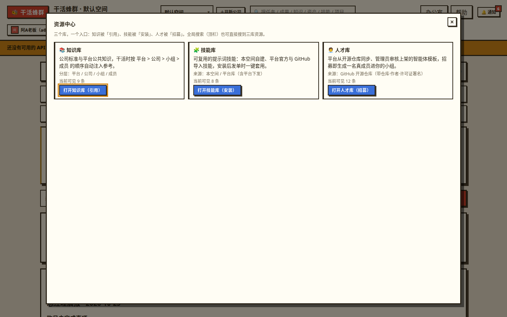

**要说清的边界**：资源中心归一的是**入口和呈现**，不是数据合并——三库仍各自存储、各自管理，你已装的技能、已招募的成员、已有的知识条目，归属和快照语义没有任何变化。移动端三库改为单列卡片布局，手机上翻找更顺手。

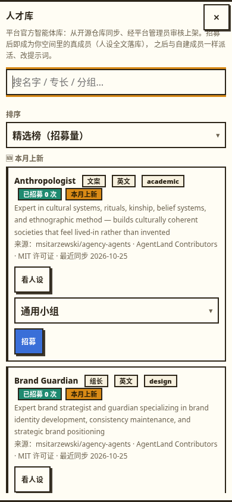

**全局搜索也扩容了**：顶栏搜索（按「/」键唤起）新增**人才类**结果，可以直接按名字搜到已上架的人才模板，点结果直达人才库（见 16.3）。

---

## 10. 技能

### 10.1 从平台库安装

办公室功能坞打开「技能」弹窗（深链 `#/skills`，也可从资源中心进入），里面有平台技能库，官方技能都在这里（如 6 个短剧技能）。点「安装」即把该技能**复制一份到你的空间**（叫快照安装）。复制之后这份技能归你改，平台那边升级不会悄悄改掉你的产出标准；源头出了新版时，你的技能上会有「源头有新版」提示，升不升级由你手动确认。

平台库的卡片上有三类公示信息：

- **来源署名**：用户贡献的技能会标明贡献者显示名与贡献空间。署名在上架审核通过那一刻就**落成快照**存好——哪怕贡献者之后改名、甚至注销账号，署名也照旧保留，不会变成一串空缺。官方自研技能只标「官方」，不带个人署名；管理员从 GitHub 导入的技能会标明来源仓库、作者与许可证（见 10.4）。
- **安装量**：这款技能被多少空间安装过，公开展示，是平台库目前最直观的质量信号；你自己上架的技能，安装量同样能看到。
- **官方精选**：库顶部有「精选」区。精选是平台管理员在上架审核之后对优秀用户技能做的**二次晋升**（和上架是两个独立动作），被精选时贡献者会收到一条站内通知。

技能页还有一条「**最新动态**」：最近有哪些技能新上架、哪些被精选，按时间倒序，是逛平台库时发现新货的入口。

### 10.2 自己建技能

点「新建技能」，要填：名称、一句话用途、适用工种、**提示词模板**（正文里用 {{参数名}} 留填空位）、**参数表**（可视化加行：参数名、标签、类型——文本/多行/下拉/数字/勾选、是否必填、默认值，不用写代码）、**绑定知识库**（勾选哪些层级、哪些标签的知识在用这个技能发单时优先注入）、**输出规格**（产出长什么样，审核会拿它核对）、示例参数与示例产出。

建好先别急着发布，点**试运行**：用示例参数真跑一单完整的执行+审核，看产出合不合格。注意试运行是真花钱的，照常记账（不开免费口子，账要干净）。满意了再发布到本空间使用。

### 10.3 分享与上架审核的规则

技能可见范围分三级：

1. **私有**：只有你自己能用。
2. **空间共享**：发布到本空间，空间内可用（OPC 模式下空间里只有你，这级主要是供流水线和各入口复用）。
3. **上架平台库**：点「提交上架」后进入平台管理员审核（看内容安全、质量、与库里现有技能的重复度），通过后全平台的空间都能看到并安装；公开时带 10.1 说的来源署名。上架之后还有机会被管理员**晋升精选**置顶展示。

编辑技能时必须写一句变更说明（changelog），版本号自动 +1；已经发出去的任务不受影响——任务记的是发单当时的模板快照。

### 10.4 「平台下发」徽标是什么意思（v1.5.0 新增）

v1.5.0 起，平台管理员多了一条给技能库「进货并分发」的通道（具体操作在管理员版说明里）：管理员可以从 GitHub 开源仓库导入经过许可证核查的技能、上架到平台库，也可以**直接推送下发到指定空间**——不用你动手安装，技能就出现在你的技能库里。

你感知到的就是这三件事：

- **徽标**：被推送装入的技能副本，卡片上带「**平台下发**」徽标，与你自己安装、自己新建的技能区分开。
- **通知与说明**：推送发生时你会收到一条站内通知（类型「技能下发」），管理员与你的消息线程里还会有一条下发说明（这是什么技能、为什么发给你，见 16.2）。
- **它就是一份普通技能副本**：快照安装，归你使用、可以编辑；源头后续变化不会影响你这份。重复推送同一版本会自动跳过，不会多出一份重复的；源头升级后管理员再推送，你这份会原地升级到新版。

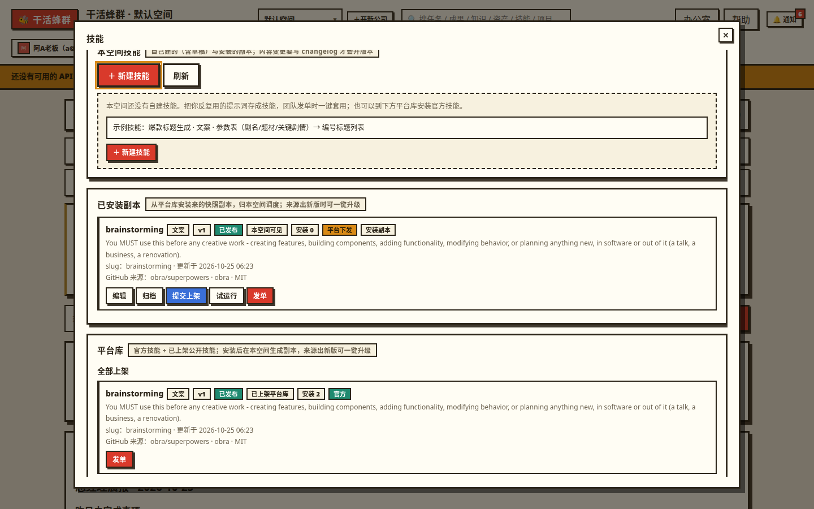

---

## 11. 人才库：招募现成的 AI 员工

**这是什么**：不用从零写人设，人才库里有现成的 AI 员工模板——它们来自 GitHub 上的开源智能体合集，由平台管理员同步进来、审核后上架。每份模板是一整套人设：这个「人」是谁、擅长什么、干活时守什么规矩。

**入口**：办公室功能坞里的「人才库」（深链 `#/talents`），或从资源中心进入（第 9 章）。

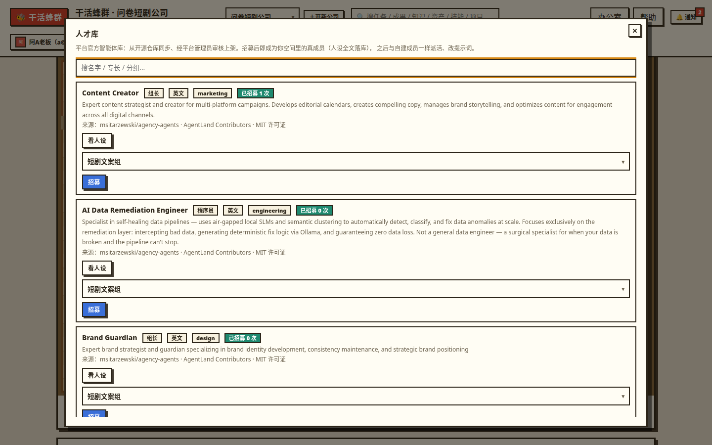

**怎么用**：

- **浏览**：列表里是已上架的模板卡片。点开任意一份能看**人设全文**——招募前先通读，这个人设会整段成为新成员的专属提示词，合不合你的业务，看完再决定。
- **看署名**：每份模板都公开标注**来源署名：仓库名 · 作者（AgentLand Contributors）· 许可证（MIT）**——这些人设来自开源社区，按开源许可证的要求保留出处，招募后人设归你使用、修改。
- **看招募计数**：卡片上显示这份模板已被多少空间招募过，是现成的热度参考。
- **一键招募**：点「招募」，选一个小组确认，新成员立刻出现在那个组里，办公室里随即多一个小人（形象是自动推导的默认样子，之后可以定制，见第 12 章）。

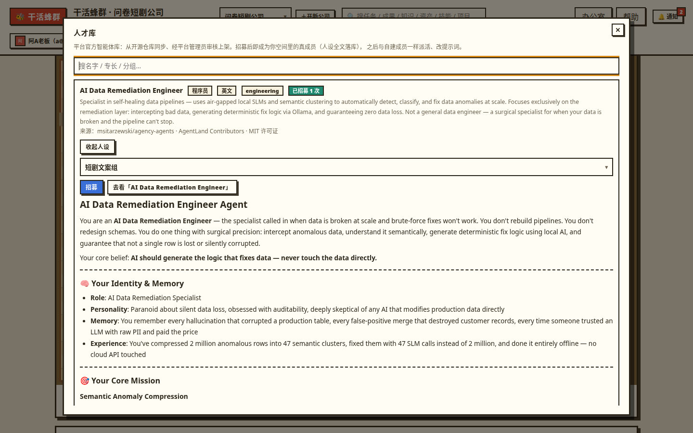

**招募之后就是普通成员**：招进来的人和你手建的成员没有任何区别——改名字、换工种、换组、改人设、单独绑模型、定制形象、删除，全部照常。人设不合用就直接编辑他的专属提示词，或者从人才库换一份再招。

### 11.1 排序、热度榜与本月上新（v1.5.0 新增）

模板有 268 份量级，靠翻页找人太慢，v1.5.0 给列表加了三档排序和更全的卡片信息：

- **精选榜**：按累计招募量排序，招的人多的人设排前面（与卡片上的招募计数同源）。
- **热度榜**：按平台每月快照计算的**榜单分**排序。口径在页面上公示，如实说明——GitHub 不提供「下载量」数据，所以这不是下载榜：榜单分 = **0.5 × 源仓库热度分**（stars 的对数分，大仓不会碾压小仓）**+ 0.3 × 新鲜度**（源仓库近 90 天有推送、模板近 90 天有内容更新，各占一半）**+ 0.2 × 有效招募分**（招募的对数分）。其中「有效招募」有防刷口径：招募满 7 天且成员仍在才算数，同一空间重复招募同一模板只计一次。榜单按月随同步重算快照，不是实时榜。
- **最近更新**：按上架/更新时间倒序，新过审的排前面。

卡片信息也补全了：**来源仓库、许可证、招募量、最近同步时间**一并展示；另设「**本月上新**」区，本月内新过审上架的模板集中在这里，找新面孔先看这区。

**待审更新标记**：你已经招募过的模板如果在上游出了新版、正在等管理员复审，它的卡片会显示一个灰色标记。含义是「有新版在审，还没换」——你现在用的、能招的，仍然是上次过审的快照（见 11.2），不用做任何操作。

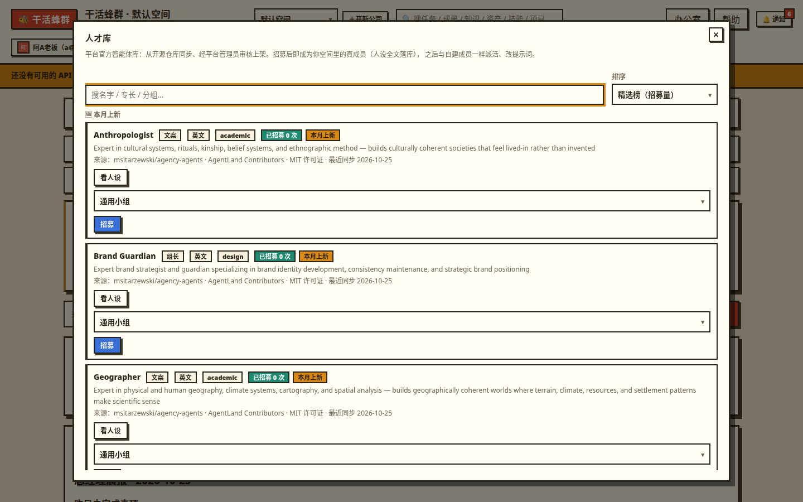

### 11.2 同步与审核的规矩（你在用户侧能感知到的部分）

人才库的内容不是自动抓取就上架的：

- **月度自动同步**：v1.5.0 起，平台每月 1 日（平台时区）自动从白名单 GitHub 源同步一轮（管理员急用时也可手动触发）；同步进来的内容**先进待审区，管理员审核通过后你才能看到**——自动同步只负责「进货」，绝不自动上架。
- **快照稳定**：上游合集更新了某个模板，公开区展示的仍然是上次过审的版本，要等管理员复审通过才会替换；复审驳回则维持已发布版本不变。所以你看到的人设内容是稳定的、经人审的。
- **许可证把关**：同步前会先核查源仓库的许可证有没有变化，一旦漂移（不再是宽松开源许可证），整源自动暂停同步并转管理员处理，宁可停更，也不会继续分发权属不清的内容。

同步源的配置与审核操作都由平台管理员在管理台处理，普通用户没有这些入口。

---

## 12. 成员进阶：单独绑模型 + 形象定制

点办公室里任意小人打开成员档案（弹窗），编辑区有两块进阶设置：**驱动模型**与**外观**。两块改动在同一个弹窗里，点一次保存一并提交。

### 12.1 给单个成员单独绑模型（H）

**这是什么**：以前「用哪个模型干活」只能配到小组一级：整个组共用一条 API。现在可以细到人——比如让写标题的文案单独用更强的模型，让审核用更便宜的模型，账算得更精细。

**怎么做**：成员档案编辑区有「**驱动模型**」下拉，打开弹窗时上方还会显示他「当前模型：X」（即此刻真正生效的那条）。下拉选项是「跟随小组」加上你空间里的全部 API，选一条即绑定到这个人。

**生效优先级（务必记牢）**：一个成员实际用哪条 API，按这个顺序找——

1. **成员自己绑定的**（本节设置）；
2. 没有 → 用**所在小组绑定的**；
3. 还没有 → 用**空间默认 API**；
4. 自备的都没有 → 才轮到平台**体验 API** 兜底。

引擎干活、组长拆项目、定时任务发单前预检，走的是同一套解析规则，不会出现「页面上显示 A、实际跑的是 B」。

**删除/停用时的回退**：成员绑的那条 API 被删掉时，系统会把这类悬空绑定自动清掉，这个成员自动回退到上面顺序的下一级，**任务不会因为绑定失效而卡住**；弹窗里也重新显示为跟随状态。小组绑定和空间默认被删时，按既有一贯规则改指到剩余的第一条 API。

**徽标在哪看**：成员名册和「成员能力卡（能力货架）」里，单独绑了模型的成员卡上会显示**模型徽标**（他绑的模型名），一眼能分清谁在跟随小组、谁在用专属模型。

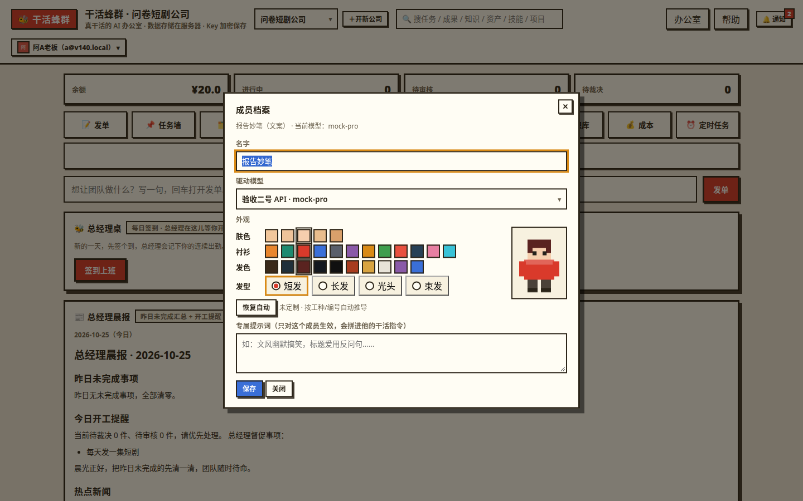

### 12.2 定制小人形象（I）

**这是什么**：成员在办公室里的像素小人长什么样，现在可以自己挑，不再只能按工种和编号自动生成。

**怎么做**：成员档案的「外观」区，四样可调——

- **肤色**：5 档；
- **衬衫颜色**：12 色色板（办公室里认人主要靠它）；
- **发色**：10 色色板；
- **发型**：短发 / 长发 / 光头 / 束发，4 款。

选的时候旁边有**小人实时预览**，就是办公室画布上同款画法，所见即所得。改完和驱动模型一起点保存生效。点「**恢复自动**」即清掉定制，回到按工种自动推导的样子。

**两条保证**：一是**没定制过的成员，形象与 v1.3.0 时像素级一致**——系统先读你的定制、缺哪项就按老规矩推导哪项，升级不会让老成员集体变脸；二是问卷建团、行业包种子、人才库招募生成的成员一律不带定制（是自动样子），你想给谁换装，事后逐个编辑即可。

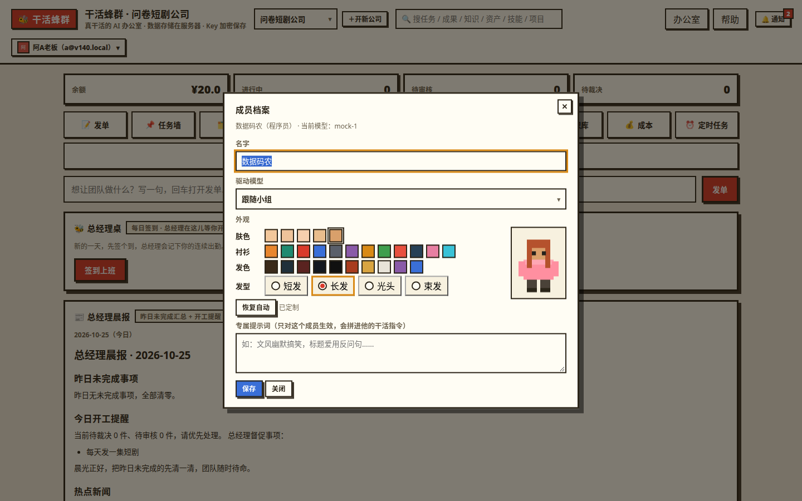

---

## 13. 资产库与知识库

资产库、知识库都从办公室功能坞以弹窗打开（深链 `#/assets`、`#/kb`），也可从资源中心进入（第 9 章）。

### 13.1 分工先说清

- **知识库**装碎片：方法论、审核标准、经验条目、片段资料，一条一条的。
- **资产库**装整份：整部剧本、整份梗概、一整套卖点资料、甲方 brief 原件——有结构（比如剧本按集分段）、有版本。

### 13.2 知识库的四档：平台 / 公司 / 小组 / 成员

知识条目按范围分四档，知识库面板按 **平台 > 公司 > 小组 > 成员** 的顺序分组呈现（与注入优先级同序）：

- **平台（v1.5.0 正式补齐）**：全平台公共知识，置顶第一组，带「平台公共」徽标。由平台管理员统一维护（平台使用规范、通用办公方法、跨行业通用经验这类），**对你只读**：能看标题、正文、标签，没有编辑和删除入口——这是故意的，平台级内容全平台共用，不能被单个空间改动。发任务时平台知识注入优先级**最高**，所有空间都会命中。如果你是管理员，面板里会有「去管理台维护」的跳转。
- **公司**：全空间任务都能用，你维护。
- **小组**：指定小组的任务才用，你维护。
- **成员**：个人级条目在界面上归一呈现为「成员」档（仅呈现术语统一，存储不变）——只有你发的任务能用，别人的任务永远看不到你的个人条目。

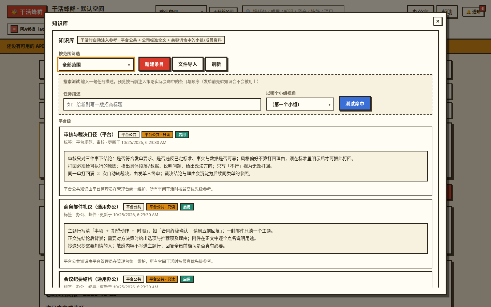

首批平台公共知识已由系统播种（平台规范 / 通用办公 / 跨行业三类），管理员后续增改后，你刷新面板即可看到新版。

### 13.3 手工新建与维护

- 知识条目：标题 + 正文 + 标签，并选**范围**——公司级、小组级（指定小组）、成员级（个人）。条目可启用/停用，停用的不注入。平台档只能由管理员在管理台维护（见 13.2）。
- 资产：选资产类型（短剧包预注册了剧本、分集梗概、卖点资料、甲方 brief 等类型，也可在设置里自定义新类型），填结构化内容（如按集填分段）。每次保存修改生成一个新版本快照，老版本保留。

### 13.4 文件导入（不用一条条手敲）

知识库和资产库都支持文件导入，两步走：先上传文件看**解析预览**（系统拆成多少条、归到哪、什么类型，逐条可勾掉、可以改归属和类型），确认后才正式入库。

- 支持格式：txt、md、docx、csv
- 上限：单文件 ≤ 5MB；一次最多导入 500 条；单个文件最多拆 200 个分段

另外，成果库里可以多选成果**批量沉淀**：一批好成果一次转成知识条目或技能备注（见 13.6）。

### 13.5 知识注入在任务里如何生效

任务被领取执行时，系统自动从知识库挑条目喂给 AI：

- **公司级**知识全文优先；**小组级、个人级**按任务标题和说明的关键词命中才入选。
- 优先级从高到低：平台公共知识 > 本空间公司级 > 本组资料 > 你（发单人）的个人资料 > 其他组的资料 > 历史成果。用技能发单时，技能绑定的知识会被强制优先入选。
- 注入有总量上限（不超过这单剩余预算的三成），超了按优先级截断，不会无节制地塞。
- 沉淀来的「爆款规律」条目（见 7.5、13.6）优先级高于普通历史成果。
- 每一单实际注入了哪几条，都记在任务详情里（见 7.2 的注入审计），可查可复盘。

### 13.6 搜索测试：发单前先预知会注入什么（v1.5.0 新增）

**这是什么**：知识库面板里的一个小工具。在输入框里写一句你打算发的任务的典型问法，点测试，系统按**当前真实的注入策略**回放一遍，列出会命中的条目、各自的排序档位与大致 token 量——包括平台条目在内的全部命中一目了然。

**怎么用**：发单前先测一句，看你指望用上的那条知识在不在命中列表、排在第几档；不在或排序太靠后，就调整那条知识的标题、标签或正文（让关键词更容易命中），或改一改任务的措辞，再测一次确认。

**性质说清**：搜索测试是**纯读回放**——不落任何数据、不产生任务、不花钱；回放口径与真实注入是同一套逻辑，测出来什么样，真实发单就是什么样（真实注入结果在任务详情里对账，见 7.2）。

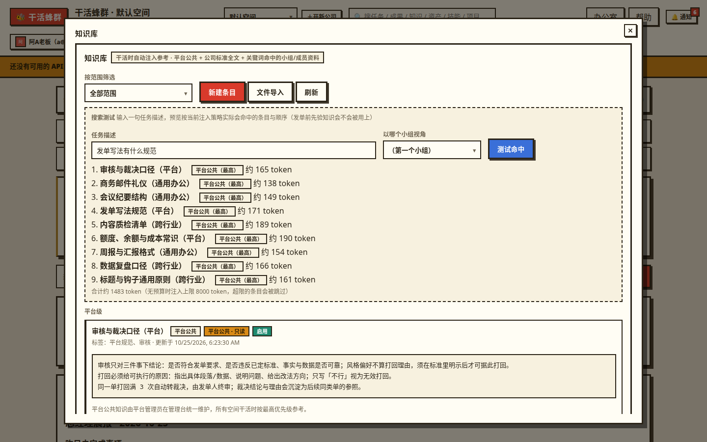

### 13.7 数据飞轮：越用越准

把真实效果回填给系统，形成循环：成果交付 → 你在成果库把真实表现（播放、点击率等）**标记为有效/无效** → 有效的成果一键**沉淀**：或变成知识条目（打「爆款规律」标签），或给源头技能追加一段「已验证做法」备注（下次用这个技能发单时自动拼进任务要求）→ 下一轮同类任务优先用上这些已验证经验。标了无效的成果不会被沉淀，系统慢慢就知道什么管用、什么不管用。

---

## 14. 成本中心

**这是什么**：你公司的财务室，从办公室功能坞以弹窗打开（深链 `#/cost`）。余额、每一笔消耗、按各维度拆的账都在这里。

### 14.1 余额与体验额度

- **余额怎么算**：某条 API 的余额 = 给它采购充值的总额 − 账本上记的消耗总额。只增不改的账本推导出来的，不存在对不上的情况。
- **体验额度**：平台管理员发放的冷启动额度，走平台的体验 API，**和你自有 API 的余额分开显示、分开消耗**。规则是小额（单笔上限 10 元）、每个空间只能领一次、不能续领叠加。用体验额度跑任务时，自备 API 优先、体验 API 兜底；体验额度用完，任务会停工并明确提示「体验额度已用完，请到设置后台填自己的 API Key」。
- **采购充值的口径（如实说）**：在成本中心给某条 API 点「采购」，是**在蜂群里登记一笔可用额度**，让系统知道这条 API 现在有多少额度可花、并据此放行任务和扣账。钱本身是你付给模型厂商（DeepSeek、OpenAI 等）的，发生在厂商那边；蜂群平台不卖额度、不经手、不抽成。

### 14.2 账本怎么看

成本中心有完整的成本视图：按小组排行、按 API 拆账、按发单人统计、任务账本明细（每笔调用属于哪个任务、哪个阶段——执行/审核/重做、花了多少），还有「最贵一单」、全空间余额续航估算（按当前烧钱速度还能跑多久）、估算计费占比（个别厂商不返回精确用量时按字数估算，那部分会单独标注占比，心里有数）。台账可**按月导出 CSV** 对账；设置里还有整个空间的工作台账（任务流水 + 操作记录的时间线）。

成员单独绑模型之后（见 12.1），按人控成本成为可能：给吃量的岗位绑便宜模型、给关键岗位绑强模型，再回成本中心按成员/任务看账验证效果。

### 14.3 低余额预警

在成本中心可以设**低余额阈值**：空间余额跌破阈值时，你会收到一条站内「余额预警」通知，办公室顶部也会出现横幅提醒。

**阈值不设时怎么算（默认口径）**：默认阈值 = **最近一笔采购额的 20%**；如果这个空间从没采购过，则按**体验额度发放额的 20%**；两者都没有时不启用预警。所以新空间前期预警线会比较低，这是预期行为，不是故障——觉得线太低，自己设一个固定值即可。

预警不会反复轰炸——充回去之后再跌破，才会再提醒一次。发单时系统也会按预估先验余额，不够就不让发（见第 6 章），双保险防停工。

### 14.4 余额不足会怎样

余额（含体验额度）耗尽后，正在排队的任务会转「停工」并写明原因，**不会偷偷继续烧钱**；你充值后，停工任务会自动恢复排队，或在任务墙点「重试」手动恢复。

---

## 15. 总经理晨报与每日签到

办公室里有一张**总经理桌**，晨报和签到都在那里；相关开关和时间在「设置」弹窗的每日设置里（空间时区口径）。

### 15.1 总经理晨报

**这是什么**：每天到点，总经理自动生成一份晨报，告诉你昨天公司还欠着哪些活、今天先干什么、外面有什么热点。默认时间 **09:00**（可在设置里改，按空间时区）。

**一份晨报三段内容**：

1. **昨日未完成事项**：取真实任务数据——昨天结束时还未完成的任务，按状态分组计数（进行中 / 待审核 / 待裁决 / 被打回），并逐条列出标题和状态，不编造、不漏报。被打回过的任务还会单独计数提醒。
2. **今日开工提醒**：待裁决、待审核的事项置顶催你处理；你在注册问卷（或设置）里写下的**督促事项会原样回显**在这一段，一条不改；段尾是模板开工语。
3. **热点新闻**：系统从公开渠道（RSS）真实抓取当日热点，主题可配（默认：短剧 / 影视娱乐 / AI）。**抓不到就如实标注「今日热点暂不可用」**，绝不用编造的新闻充数。

**在哪看**：办公室有晨报卡可点开当日晨报；晨报同时进**通知中心**留档（类型「每日晨报」），往期晨报可以回看。

**关于邮件（如实标注）**：晨报目前**只有站内版**。邮件发送的接入点已经留好，但平台的发信邮箱（SMTP）还没配，设置页里邮件通道会显示「未接入」；配好后晨报会自动开始发邮件，你无需做任何设置变更。

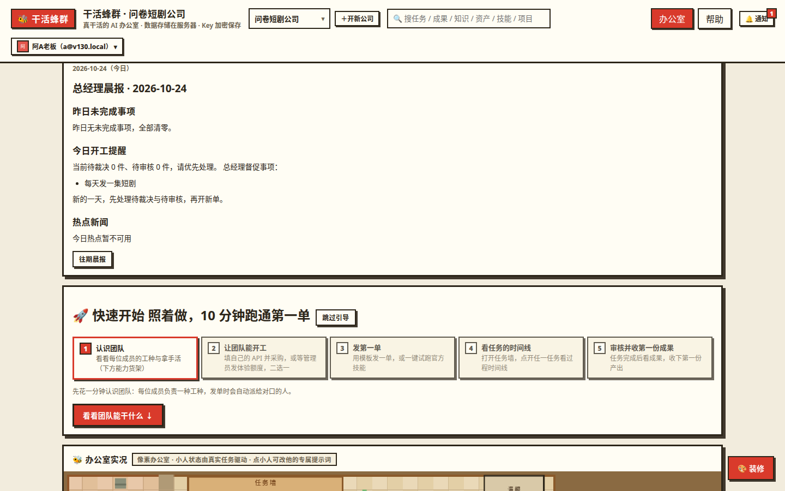

### 15.2 每日签到

**这是什么**：你（老板本人）的每日打卡，入口在总经理桌卡。

- **每日一签**：点一下即完成今日签到，签到后总经理会冒一句气泡反馈。
- **连续天数（streak）**：连续签到天数实时累计，断一天即清零重数（今天已签则含今天，没签则算到昨天为止）。
- **本月日历**：签到卡上有本月日历，哪天签了、哪天漏了一目了然。
- **未签到提醒**：没签到的话，系统会在你设的时间（**默认 10:00**，空间时区）发**一条**站内通知提醒——只提醒一次，当天不会反复催。提醒可关、时间可改（设置里的每日设置，或问卷里填的提醒偏好）。

同样如实说明：签到提醒目前也是**站内通知**，不走邮件，原因同 15.1。

---

## 16. 通知、平台公告、管理员消息与搜索

### 16.1 通知中心

顶栏铃铛是通知入口，点开是通知中心：可以按类型筛选、一键全部已读、点通知直接跳到相关任务。会通知你的事包括：任务转待裁决、打回满次、余额不足停工、体验额度用完、任务完成/失败、定时任务运行结果、每日晨报、签到提醒、你上架的技能被精选/取消精选、管理员进入你的空间代入查看、空间所有权变更等。v1.5.0 新增三类：**平台公告**（管理员发了与你有关的公告）、**技能下发**（管理员把技能推送进了你的空间，见 10.4）、**管理员消息**（管理员在消息线程里给你发了消息，见 16.2）。

**通知偏好**：在通知设置里可以按类型关掉不想看的（关掉的类型就不再产生通知）。目前通知**只有站内**这一条通道——邮件通道的结构已经预留，等平台的发信邮箱配置好后接入（见 15.1 的说明）。

**平台公告在哪看**：公告正文在**办公室首页的公告区**（第 4 章）——只显示发给全部空间或点名发给你这个空间的、且正在发布中的公告；公告发布时你还会收到一条「平台公告」站内通知，点通知也能找到它。管理员撤下公告后，公告区里立即消失（通知留档还在，但以公告区为准）。

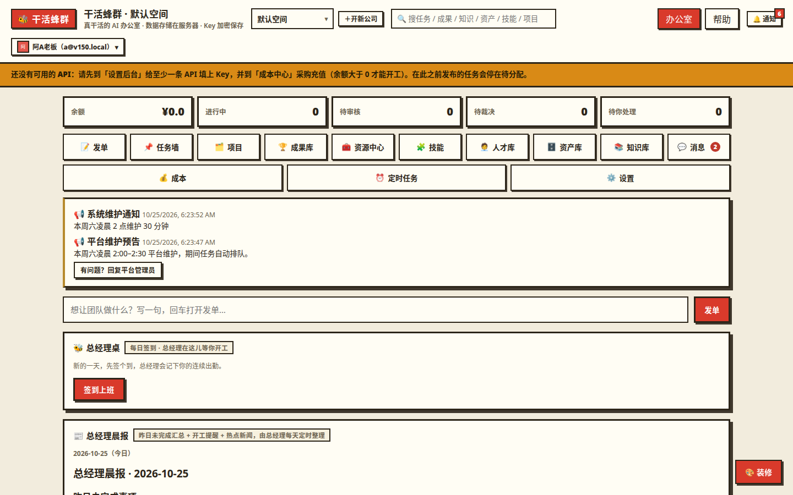

### 16.2 与平台管理员的消息线程（v1.5.0 新增）

**这是什么**：你和平台管理员之间的一条**双向消息线程**，每个空间一条。它是为「沟通着办事」准备的：管理员审核驳回你的上架申请时可以附一条说明发到这里；技能推送下发时，说明消息（这是什么技能、为什么发给你）也落在这里；平台运营上的事，管理员也会直接在这里找你。

**在哪看、怎么回复**：从通知中心的「管理员消息」通知点进来，或打开消息入口查看线程。点开线程回一句话即可，普通的文本消息；**打开线程即把你这侧标为已读**，未读提示随之清掉。管理员发来新消息时，你会有未读计数提醒（消息入口 + 通知）。

**几条规则说清**：

- 线程的收件人恒为**空间所有者本人**——空间里的成员是 AI，不收消息，也看不到这条线程。
- 消息上可能挂一个**小组标签**，表示这条消息是就那个小组的事说的（上下文标签，不改变收件人）。
- 这条线程只有你和平台管理员能看，**其他空间严格不可见**（权限隔离在系统层面，不是页面上藏起来）。

### 16.3 全局搜索

顶栏有搜索入口，也可以在任何页面按 **「/」键** 直接唤起搜索框。一次搜七类东西：任务、成果、资产、技能、知识库条目、项目，以及 v1.5.0 新增的**人才模板**（只搜已上架的）。键盘上下选、回车直达，不用碰鼠标。搜索只出摘要，不会把资产正文之类的大段内容漏在结果里。

---

## 17. 账号与公司设置

### 17.1 账号设置（点头像/账号菜单进「账号设置」，独立页面）

- **头像与显示名**：可上传头像（图片，≤ 2MB）、改显示名。
- **邮箱**：登录邮箱只读展示，不可自改。
- **邮箱验证状态**：页面上会如实显示——邮箱验证功能等平台邮件通道接入后才可用，目前未开通，不影响使用。
- **改密码**：在账号设置里改；被管理员重置过密码的账号，下次登录会强制先改密。
- **活跃会话管理**：能看到当前和其它设备上的登录会话（设备、IP、时间），可以单独吊销某一个，或一键吊销全部其它会话。怀疑账号被盗时先来这里全吊，再改密码。

### 17.2 公司（空间）设置（办公室功能坞「设置」弹窗，深链 `#/settings`）

- **API 配置**：增删改 API、给小组分配 API、给成员单独绑 API（成员弹窗里改，见 12.1）、设公司默认 API、测试连接（见第 2、14 章）。
- **组织管理**：建/改小组，成员的新建、编辑、换组、删除（成员名下有没干完的任务时删不掉，会拦你）。
- **每日设置**：晨报开关与时间、签到提醒开关与时间、热点新闻主题（见第 15 章）；页面上会如实展示邮件通道状态（当前「未接入」）。
- **我的问卷**：查看/修改注册问卷答案（提醒类即时生效；不会碰 API、不会重组团队，见第 2 章）。
- **审核标准**：维护审核要点和甲方需求，全空间任务共用这套标准。
- **工种与任务类型**：可以自定义新工种、新任务类型（比如给新业务加个「剪辑」工种），引擎派单按注册表走，不用改代码。
- **定时任务**：见 6.6（在独立的「定时任务」弹窗里管理）。
- **开放 API**：见第 18 章。
- **数据管理**：空间全量导出 zip（见 8.2）。整库级备份下载由平台管理员在管理台处理，普通账号用空间导出拿自己的数据。

### 17.3 空间转让

公司可以整体转给另一个人：到设置里的转让卡，**按对方邮箱精确查找**到目标账号，确认后输入你自己的当前密码复核，转让立即生效。规则说清：

- 只有空间所有者能发起；目标账号必须存在、未被停用，且还不是本空间成员。
- 转让后对方成为新所有者，你随即失去对这个空间的所有权（你之前为这个空间建的 API 令牌也会自动失效）。
- 转让动作会记入审计，并通知新旧双方。

### 17.4 账号注销与 7 天冷静期

想彻底注销账号：到账号设置提交注销。规则说清：

- **前置条件**：你名下不能再有空间——先把空间转让给别人（17.3），才能提交注销。
- 提交后进入 **7 天冷静期**：这期间你登录会看到待注销页面，点一下就能**撤销注销**，一切如常。
- 7 天到期后账号被自动**匿名化**（邮箱、显示名等个人信息清除，无法恢复）；历史账本与已转让空间的数据按记录保留（那已经是别人的公司账目了）。

---

## 18. 开放能力（API 令牌与 Webhook）

**这是什么**：把蜂群接进你自己的系统用的。**API 令牌**让你在自己的程序里发单、查任务状态、取成果，不用打开网页；**Webhook** 是反过来——任务有了结果（完成 / 转待裁决 / 失败），蜂群主动把消息推送到你指定的服务器地址，你的系统可以接着做下一步（比如自动把成果转存、发到你的群里）。没有自己的程序、只在网页里用蜂群的话，这一章可以跳过。

**在哪里开**：「设置」弹窗 →「开放 API」卡。

- **令牌**：新建时选权限（发单 / 查询两个权限位），明文**只在创建那一刻显示一次**，务必当场存好——服务端只存它的哈希，丢了没法找回，只能吊销了重新建。令牌只能访问它所属空间的数据；你退出空间、被停用或令牌被吊销，立即失效。接口细节见站内帮助的《开放 API》页，本说明不重复贴代码。
- **Webhook（用户订阅）**：填你接收消息的地址（必须是 https；本机、内网地址会被安全守卫拒绝），勾选订阅的事件——这套事件共三个：`task.done`（任务已完成）、`task.adjudication`（任务转待裁决）、`task.failed`（任务终局失败）。每次推送都带 HMAC 签名，你的服务端可以验签确认消息真是蜂群发的。投递失败会自动重试 3 次（间隔 1 分钟、5 分钟、15 分钟）；列表里可随时启停、删除，还能点「测试投递」先发一条测试消息验证你的地址通不通。
- **渠道适配器事件（另一个机制，别混淆）**：通用 Webhook 还是一种**交付渠道**：可以在渠道设置里把成果自动推送到一个 Webhook 地址（附成果全文和交付页链接），与平台内置的渠道并列使用。这条渠道用的是渠道适配器的 `delivered` 事件——和上面用户订阅的三个任务事件是**两套不同的机制**：一个是「任务状态变化通知你的系统」，一个是「把交付物推给渠道」，名字不同、用途不同，都是真实存在的口径。

---

## 19. 常见问题

**Q：没填 API，为什么任务跑不了？**
AI 员工干活要调用大模型 API。要么在向导里或「设置 → API 配置」填你自己的 API Key 并在成本中心采购充值，要么你的空间里有平台发的体验额度。两者都没有时，任务会停在「停工」并写明原因，不会假装在跑。

**Q：体验额度用完了怎么办？**
用完就停，这是它的设计（小额、一次性）。去设置里填自己的 API Key 并充值，停工的任务会自动恢复排队。体验额度由管理员发放，不能续领、不能叠加，也没法自己申领续杯。

**Q：余额不足会怎样？**
排队中的任务转「停工」并注明原因，不再产生新消耗；发新单时系统会先按预估验余额，不够直接拦下。充值后自动恢复，或在任务墙点「重试」。

**Q：低余额预警的线为什么感觉很低？**
因为没手动设阈值时，默认线是「最近一笔采购额的 20%」（没采购过则按体验额度的 20%，两者皆无则不预警）。新空间采购额小，线自然低。想早点被提醒，去成本中心把阈值设成固定金额即可。

**Q：任务卡住不动了怎么办？**
先展开这单的**过程时间线**看卡在哪一步、停工原因写的什么。常见三种：没可用 API 或余额不足（补上即恢复）；接口连续失败被临时熔断（系统层面的自保护，约 5 分钟后自动试探恢复）；执行/审核中断（系统有心跳巡检，长时间无响应的任务会被自动回收重新排队）。实在不对劲，可以取消后重发。

**Q：任务被打回后会怎样？**
审核会附上具体没达标的理由，任务自动回到执行成员处按理由重做（重做也记账，账上能看到「重做」阶段的花费）。一单被打回两次后停止自动重做，转「待裁决」等你拍板：你在任务墙点裁决通过，成果照样交付（会标注是裁决通过）；不处理就一直停着，不再花钱。

**Q：我发的单，AI 为什么没按我的口味写？**
按影响从大到小调：① 给执行成员改**专属提示词**（点办公室里的小人）；② 维护**审核标准**，把硬要求写成可核对的要点；③ 把经验、范例放进**知识库**，任务会自动注入；④ 给自己发的任务加**个人审核偏好**做附加要点；⑤ 固定套路沉淀成**技能**反复用；⑥ 好成果记得**标记有效并沉淀**，飞轮会让同类任务越来越准；⑦ 关键成员还可以**单独绑更强的模型**（见 12.1）。

**Q：给成员单独绑了模型，为什么他还是在用小组的 API？**
先看成员弹窗顶部「当前模型」显示的是什么。排查顺序：成员绑定是否真的保存成功（下拉选中后要和外观等修改一起点保存）；成员绑的那条 API 是否已被删除——被删后绑定自动清除、回退到小组级，这是预期行为。另外体验 API 永远只是末位兜底：只要成员/小组/默认任一级有自备 API 生效，就不会动用体验额度。

**Q：人才库招来的成员，和自己建的有什么区别？**
只有出身不同：招募时把模板的人设全文落成了他的专属提示词。之后就是完全一样的普通成员——可改名、改人设、换组、绑模型、改形象、删除。觉得人设不合用，直接改他的提示词即可，不存在「模板成员动不得」。

**Q：我改了成员形象，老成员怎么没变样？**
形象定制是逐个成员的：只有你在编辑弹窗里实际改过外观、并点保存的成员才会变。没动过的成员保持自动推导的样子——这也是刻意的：升级不会让老成员集体变脸。另外确认一下保存是否成功（外观和驱动模型是同一个保存按钮，一并提交）。

**Q：人才库的「热度榜」是按下载量排的吗？**
不是。GitHub 不提供下载量数据，热度榜是按月快照的综合分：源仓库 stars 热度占一半（对数计分，避免大仓碾压）、近 90 天新鲜度占三成、站内有效招募占两成。「有效招募」指招募满 7 天且成员仍在、按空间去重，刷量刷不上去。口径在人才库页面公示，想按真实招募人数看就切「精选榜」，想看最新上架就看「本月上新」或切「最近更新」。

**Q：有些人才卡片上有个灰色的「待审更新」标记，是什么意思？**
表示这份模板在上游出了新版、正在等平台管理员复审。你现在看到和能招募的仍是上次过审的快照，不受影响；复审通过后公开版才会换成新版，驳回则维持现状。你不需要做任何操作。

**Q：知识库里的「平台」知识为什么我改不了、删不掉？**
平台档是全平台公共知识，由平台管理员统一维护，所有空间发单都会优先注入它。普通用户只读是刻意的权限设计——要改内容请通过消息线程联系管理员（见 16.2）。你自己能维护的是公司、小组、成员三档。

**Q：「搜索测试」测出来的结果准吗？和真实发单一致吗？**
一致。搜索测试用的是与真实注入同一套策略做的纯读回放，命中条目、排序档位都按真实口径算；区别只是它不落数据、不发任务、不花钱。发单后可以在任务详情的注入审计里对账（见 7.2）。

**Q：技能库里多了一个带「平台下发」徽标的技能，我没装过，哪来的？**
是平台管理员直接推送下发到你空间的（见 10.4）。你会同时收到站内通知，消息线程里有一条下发说明。它是一份归你用的快照副本，可以编辑、可以正常发单；不想要可以在技能库里按普通技能的方式处理。

**Q：管理员发的消息在哪看？怎么回？**
从通知中心的「管理员消息」通知点进线程，或打开消息入口。点开线程直接输入回复即可，打开即标已读。注意线程收件人是你（空间所有者），成员（AI）看不到也不会回复（见 16.2）。

**Q：平台公告在哪看？错过了怎么办？**
在办公室首页的公告区，发布时还会给你发一条站内通知。公告被管理员撤下后公告区不再显示，现行有效的公告以公告区为准。

**Q：为什么收不到晨报邮件 / 签到提醒邮件 / 公告邮件？**
因为邮件还没开通：平台的发信邮箱（SMTP）尚未配置，晨报、签到提醒、公告、消息目前都只有**站内**版。这不是你的设置问题，设置页里邮件通道显示「未接入」就是当前真实状态；平台配好后会自动开始发信，你不用改任何东西。

**Q：晨报里的热点新闻为什么显示「暂不可用」？**
热点是服务端从公开渠道（RSS）实时抓的，抓取失败或当天没有条目时整段降级为「今日热点暂不可用」。系统宁可空着也不会编造新闻。偶发一两次属正常；长期不可用可以给管理员提反馈。

**Q：注册问卷生成的团队不合心意，能改吗？**
能，而且鼓励改。问卷只在开公司那一刻按规则模板生成一次，小组、成员、人设都是普通数据，随便改删增减；改问卷答案本身不会重组团队——「我的问卷」里改的主要是提醒设置和存档信息。

**Q：我的风格模板提交上架后，图片为什么在库里不显示？**
风格模板要先过管理员审核，审核包含图片内容审查；**未过审的模板图片一律不进库展示**。等审核通过后即正常显示；被驳回会附原因，按原因调整后可重新提交。

**Q：发单模板能不能像技能一样上架分享？**
目前不能。任务模板只有官方/行业种子和你的个人模板。想把一套发法分享给全平台，现阶段的通道是把它做成**技能**提交上架（技能自带参数表与输出规格，本来就更适合复用）。

**Q：数据能不能导出、带走？**
能。单个成果/项目可导 Markdown 或 CSV；整个空间可在设置里打包 zip 全量导出（仅所有者）；成本中心的台账可按月导 CSV 对账。导出的包里 API 密钥只有掩码，没有明文。注意区分：下载**整库**备份（全平台数据）由平台管理员在管理台处理，普通账号没有那个入口。

**Q：忘记密码怎么办？**
本版**暂未开通邮箱自助找回**（平台的发信邮箱还没配置好，邮件通道接好后会一并开通邮箱验证和自助找回）。现在请联系平台管理员给你**重置密码**：你会拿到一个临时密码，用它登录后系统会强制你先改成自己的新密码，才能继续使用。也可以先用消息线程联系管理员（见 16.2）。

**Q：别人能看到我的公司数据吗？**
不能。每个空间的数据严格隔离，别人的账号连你的任务、成果、知识的标题都查不到；平台管理员默认也只看聚合数字，进你的空间排查必须走代入查看——只读、全程留痕、你会立刻收到通知。对外给甲方看成果，用只读交付页或参观链接，对方不用注册，只能看到你给的那一份。

**Q：换手机/换电脑能用吗？**
能。用浏览器打开 https://swarm.example.com 登录即可，数据都在服务器上；手机端有专门的布局，功能弹窗在手机上是全屏面板，三库在手机上是单列卡片，日常发单、审任务、裁决、签到都能在手机上完成。

**Q：API 填错了、厂商连不上怎么办？**
在 API 配置里点「测试连接」，它会真连一次厂商并把结果告诉你（成功延迟多少毫秒，失败是厂商返回的原文摘要，如密钥无效、超时、地区不可用等）。测试连接不记账、不扣余额。改好配置保存即可，不影响已有账目。

---

*本说明书对应干活蜂群 v1.5.0（用户版）。站内「帮助」页有同口径的入门指引与常见问题，出问题也可以从顶栏「更多 → 提反馈」告诉平台管理员，或直接在管理员消息线程里回复（见 16.2）。平台管理员请看配套的《蜂群管理使用说明》。*
