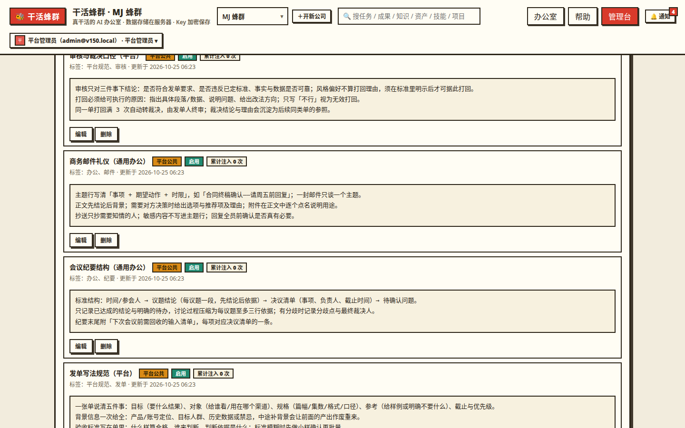
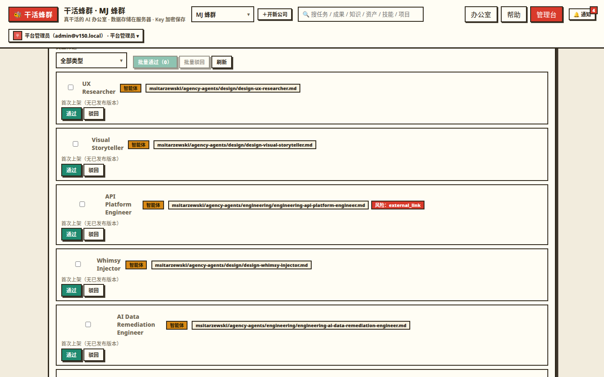
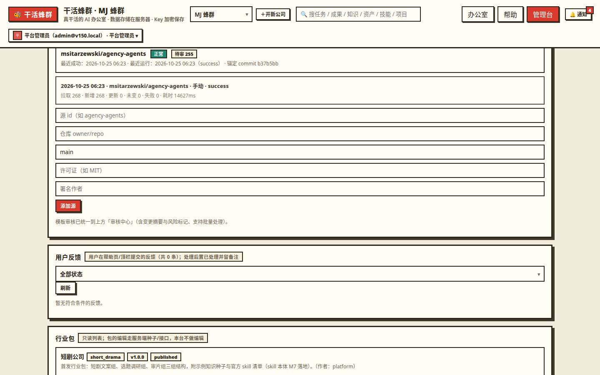
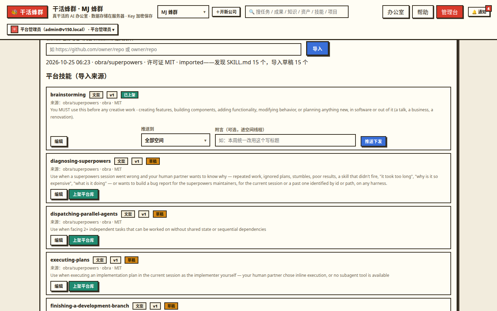
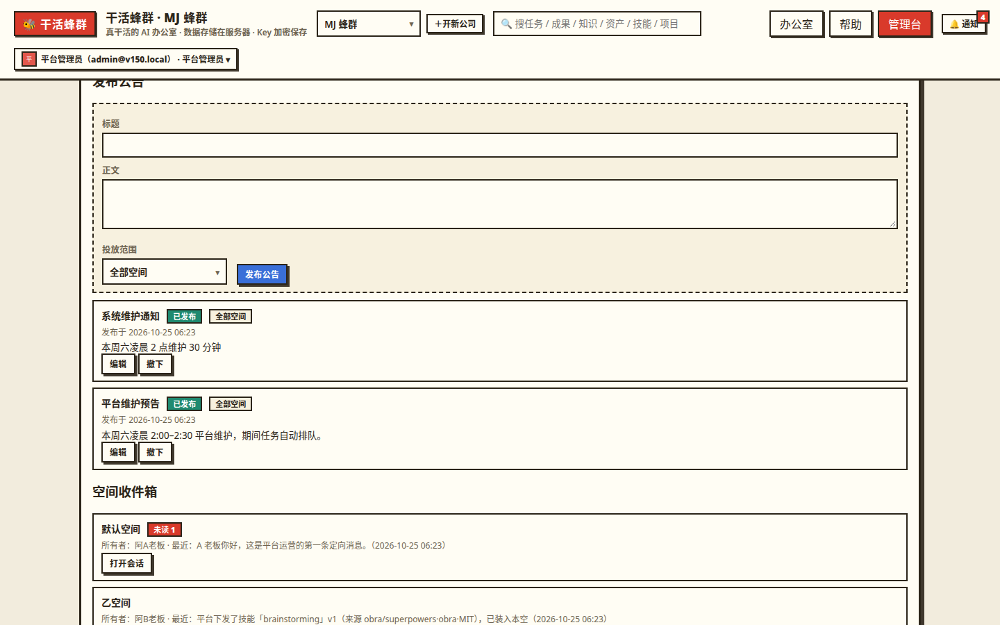
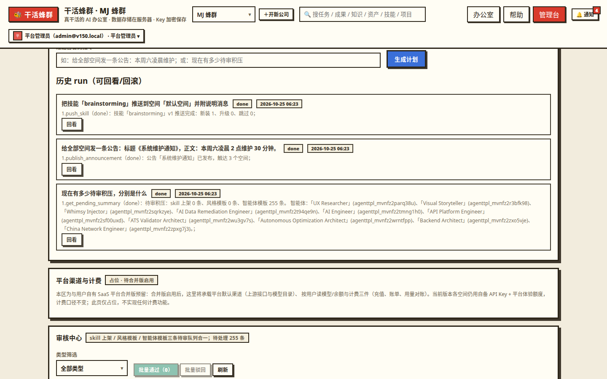

# 干活蜂群 · 管理使用说明（管理员版）

- **版本**：v1.5.0
- **访问地址**：https://swarm.example.com
- **适用对象**：平台管理员（平台最高权限账号）
- **配套文档**：《蜂群平台使用说明》（用户版，讲空间所有者的日常使用）

---

## 1. 管理台总览

**入口**：用平台管理员账号登录后，顶栏出现「管理台」入口——它是一个**独立页面**（不走办公室弹窗）。普通账号与空间所有者账号没有这个入口；本说明里的全部接口与操作都做了管理员收口，非管理员调用一律 403。

**管理台管什么**：平台层面的六类事——人（用户与注册）、额度（体验额度与平台体验 API）、空间治理、内容资产的平台级部分（平台知识、三库审核与分发、人才同步）、与用户的沟通（公告与消息）、以及把上述动作交给 AI 代办的「AI 运营官」。空间内部的业务数据（某家公司的任务、成果、知识正文）默认**不在**管理台可见范围：你看到的是聚合数字，进空间排查必须走代入查看（见 4.2），这是定死的规矩。

**三条全局纪律，先说在前面**：

1. **审计留痕**：本说明标注「记审计」的操作都会写平台审计日志（谁、何时、对什么、做了什么），事后可查，不可抵赖。管理动作宁可慢一步，不要绕开界面直接改库——绕开就没有审计。
2. **快照语义**：技能、人才、风格模板分发给空间后都是**快照副本**，与源头脱钩。你在平台侧改源、升级源，都不会自动改动已装进空间的副本；要让空间用上新版，走各章的正规路径（源头新版提示后由用户确认、或推送下发升级）。
3. **邮件未开通**：平台的发信邮箱（SMTP）尚未配置，公告、消息、晨报、审核通知目前**全部只有站内触达**。管理台与设置页里邮件通道显示「未接入」是真实状态，不是故障；配好 SMTP 后自动启用，无需改代码。

**v1.5.0 管理端的变化一览**：平台知识有了正式维护入口（第 5 章）；三条审核队列合并为**统一审核中心**（第 6 章）；人才同步改为**月度自动流水线**、手动触发保留（第 7 章）；新增**技能下发**（第 8 章）、**沟通运营**（第 9 章）与 **AI 平台运营官**（第 10 章）；「平台渠道与计费」只留了占位页（第 13 章）。

---

## 2. 用户管理与注册审核

**入口路径**：管理台 →「用户管理」。

**你能做什么**：

- **注册审核**：绝大多数注册自动通过；被风控拦下的异常注册进入待审核——通过则开通，不通过则拒绝。审核只针对异常注册，日常不用守着。
- **停用账号**：停用**即刻吊销该账号的全部登录会话**，对方手里的令牌、会话同时失效。停用是可恢复的管理动作（区别于用户自助注销的匿名化，见用户版 17.4）。
- **重置密码**：给忘记密码的用户生成**临时密码，只显示一次**，务必当面/私下转交；对方用临时密码登录后会被**强制先改密**才能继续使用。本版没有邮箱自助找回（邮件未开通），重置密码就是找回通道——用户也可以先通过消息线程找到你（第 9 章）。
- **登录记录**：查看账号的登录历史，排查异常登录（陌生 IP、频繁失败）。

**注意事项**：重置密码、停用都记审计；临时密码不要写进公告或任何公开渠道。给自己（管理员账号）也要留一条可达的联系方式，避免把唯一的管理员锁在门外。

**审计留痕点**：注册通过/拒绝、停用/恢复、重置密码，全部记审计。

---

## 3. 体验额度与平台体验 API

**入口路径**：管理台 →「体验额度」/ 平台体验 API 配置卡。

**这是什么**：新空间冷启动用的平台级额度：走**平台体验 API**（一条平台统一维护的 API 配置），空间所有者不用先填自己的 Key 就能试跑。体验 API 还是第 10 章 **AI 平台运营官的驱动模型来源**——运营官解析指令用的就是这条 API，它没配好，运营官会直接报错（见 10.6），所以这条配置是两处共用的基础设施，请保持可用。

**操作步骤**：

1. **配置平台体验 API**：填服务商、Base URL、模型与 Key，保存后点「测试连接」验证真能连通。Key 加密存储、页面只回掩码。
2. **发放体验额度**：选目标空间发放。规则是硬的：**单笔上限 10 元、每个空间只能领一次、不可续发叠加**——发错了没有「再补一笔」的口子，先确认再发。
3. **看聚合**：管理台能看各空间的发放与消耗聚合（谁领了、用了多少），用于防薅和判断冷启动效果。

**消费口径**（与用户版一致）：空间用额度跑任务时，自备 API 优先、体验 API 兜底；额度用完任务停工并明确提示用户去填自己的 Key。解析优先级全文是：成员绑定 → 小组绑定 → 空间默认 → 平台体验 API 兜底。

**注意事项**：体验 API 的 Key 是平台资产，它被全平台新空间和运营官共用——轮换 Key 时先确认新 Key 可用再保存，避免全平台冷启动与运营官同时断粮。

**审计留痕点**：额度发放记审计；体验 API 配置变更记审计。

---

## 4. 空间治理与代入查看

### 4.1 空间总览（只看聚合）

**入口路径**：管理台 →「空间总览」。看全平台各空间的聚合用量：任务数、总消费、余额水位、成员数等。**只看聚合，不看明细**——任何空间的任务内容、成果、知识正文都不在这里出现。判断平台健康度、找异常烧钱的空间，用这一页；要看内容，走 4.2。

### 4.2 代入查看（进空间排查的唯一正道）

**入口路径**：空间总览 → 目标空间 →「代入查看」。

**规则很严，逐条记牢**：

- **全程只读**：代入状态下任何写操作都会被系统拦下，你改不了对方任何数据；
- **进出留痕**：进入和退出都记审计；
- **对方立刻知情**：空间所有者会**立刻收到站内通知**，不存在「悄悄进去看一眼」；
- **自我提醒**：你自己顶栏挂红色横幅提示正处于代入状态，点横幅即可退出。

**使用场景**：用户报障、数据对账、审核争议复核。用完即退，不要挂着代入状态处理其他事。

### 4.3 空间处置的边界

日常治理动作（停用账号等）在第 2 章；**停用空间**属于破坏性动作，本版不在管理台给单独按钮——它进了 AI 运营官的动作目录且被列为破坏性步骤，必须在计划预览里由你点确认才执行（见 10.4）。空间所有权转让由所有者本人在用户侧发起（用户版 17.3），管理员不代办。

**审计留痕点**：代入进出、一切空间级处置，全部记审计。

---

## 5. 平台知识维护

**背景一句话**：知识库的「平台」档后端早就存在（创建走管理员收口、注入优先级最高），缺的是维护入口、前端呈现和内容——v1.5.0 三处补齐，本章讲维护侧；用户侧呈现见用户版 13.2。

**入口路径**：管理台 →「平台知识」维护卡。（在用户端知识库面板的平台分组里也有「去管理台维护」跳转。）

**操作步骤**：

1. **新建**：填标题、正文、标签，保存即落为平台条目（归属全平台，不属于任何单个空间）。
2. **编辑**：直接改标题/正文/标签保存。改动对全部空间的下一次任务注入生效；已经跑完的任务不受影响（注入记录是当时的快照）。
3. **启停**：停用的条目不参与注入，适合临时下线一条有争议的知识而不删除。
4. **删除**：真删。删前先看它的注入计数——被高频注入的条目删除会影响面，先停用观察再删更稳。

**注入计数怎么看**：维护列表里每条平台知识带「注入计数」——由各任务实际注入记录聚合，回答「这条知识到底被用过多少次」。计数长期为 0 的条目，要么写得不命中（标题/标签与任务措辞对不上），要么内容没人需要， consider 改写或下线；计数高的条目改动时格外慎重。

**首批种子**：系统已幂等播种首批 **9 条**平台公共知识（平台规范 / 通用办公 / 跨行业通用各 3 条）。播种按标题判重：同标题跳过、**不覆盖你后续的手工改动**，重复执行播种不会把内容打回出厂状态。

**写平台知识的把关标准**（重要）：平台条目**注入优先级最高、所有空间都会命中**。只写全平台通用的内容——平台使用规范、通用办公方法、跨行业经验；行业专属内容放行业包的公司级知识，不要塞进平台档污染所有空间。非管理员通过接口创建平台条目会被 403 拒绝，这是后端守卫，不是页面隐藏。

**审计留痕点**：平台知识的新建、编辑、启停、删除全部记审计；运营官代办的改动同样留痕且可按快照回滚（见 10.5）。

---

## 6. 统一审核中心

**这是什么**：v1.5.0 把原来分散的三条待审队列——**技能上架、公司风格模板、智能体模板**——合并进管理台的一个「审核中心」。旧的分散审核卡已下线（原单条审核接口保留）。三类内容的审核语义各自不变，变的是你处理它们的工作台。

**入口路径**：管理台 →「审核中心」。办公室实况栏的「待你处理」计数里也含审核中心待审数（管理员口径），点入口可直达。

### 6.1 队列与变更摘要怎么看

- **按类型筛选**：队列顶部可按技能 / 风格 / 智能体过滤，也可全量混排按等待时长处理。
- **每项带变更摘要**，先看摘要再决定要不要翻全文：
  - **技能**：版本号与本次变更说明（changelog）——看它改了什么、与库里现有技能重不重；
  - **风格模板**：配色、家具清单与**待审图片缩略图**——图片内容过审在这里完成，未过审模板的图片不进库展示；
  - **智能体模板**：草稿与公开版的**字段差异**（改了哪几段人设），外加同步流水线打的**风险标记**（risk，见 7.3）——带风险标记的先看标记命中的段落。
- **署名快照**：通过那一刻，贡献者与贡献空间的署名按快照落定，之后贡献者改名、注销都不影响已公示署名（与用户版口径一致）。

### 6.2 批量通过 / 驳回怎么操作

1. 勾选多项 → 点「批量通过」，逐项执行各队列原有语义，通过结果逐项回执（哪几项成功、哪项失败及原因），不是「全成功才算数」的假批量。
2. **驳回必须填原因**：批量驳回时原因必填，**缺原因整单拒绝（400）、不部分执行**——先写原因再提交。原因会展示给提交者，是对方修改重提的依据，写具体（哪条不合规、怎么改）。
3. **驳回可附说明消息**：驳回时可勾选/填写一条说明，随驳回自动发进**对应空间的消息线程**（第 9 章），对方在线程里能直接回话追问。例外：智能体模板没有所属空间，驳回附言无处可落，不发线程。
4. 风格模板的图片在摘要里看不清时，点开看大图再拍板——图片过审是硬把关，宁可驳回让对方换图。

### 6.3 智能体模板的复审语义（沿用 v1.4.0，务必记牢）

- 同步进来的新模板：待审 → 通过上架 / 驳回（必填原因）。
- **已上架模板遇上游更新**：只标「待复审」，**公开版保持旧快照不变**，用户侧照常招募旧版；你复审通过，公开版才替换为新内容并刷新上架时间；**复审驳回则草稿回滚为已发布版本**（若上游与发布版仍有差异，下一轮同步会重新提报复审，这是预期语义，不是 bug）。
- 首次被驳回的模板，上游再更新时会自动回到待审。

### 6.4 技能精选（审核之外的二次晋升）

对已上架的用户技能，你还可以做**晋升精选 / 取消精选**（与上架审核是两个独立动作）：精选的技能在平台库顶部精选区展示。晋升、取消都记审计，并站内通知贡献者。

**审计留痕点**：通过、驳回（含原因）、精选晋升/取消，全部记审计。

---

## 7. 人才库同步源与月度自动同步

**背景**：v1.4.0 时同步是「管理员手动点一轮」。v1.5.0 升级为自动流水线：**每月 1 日（平台时区 Asia/Shanghai）自动跑一轮**，手动「立即同步」保留，应急和新源首跑用。两点先钉死：自动同步**只写草稿、绝不自动上架**，过审永远在审核中心（第 6 章）；自动与手动共用同一套运行记录。

**入口路径**：管理台 → 人才库/同步源卡（白名单维护、立即同步、流水线看板）。

### 7.1 白名单同步源管理

- **当前源**：GitHub 仓库 `msitarzewski/agency-agents`（MIT 许可证，署名 AgentLand Contributors，许可证原文已核实），含 268 份 agent 人设。
- **新源入白名单前必须逐个核 LICENSE 原文**：无宽松许可证（MIT / Apache-2.0 / BSD / ISC 这类）不入白名单——这是红线，新源先核证再配置，不要先同步再补票。
- 源的启停在白名单里维护；停用的源不参与月度自动同步。

### 7.2 流水线四段在干什么

每一轮同步（自动/手动相同）依次走四段，看板与 run 记录按段留痕：

1. **许可证漂移检查**：拉源仓库 LICENSE 原文重新归类，与白名单登记比对。**对不上 → 整源暂停**（本轮及后续自动同步都跳过该源），run 记录留痕，并给你发站内告警（类型「同步告警」）。注意：拉取**失败**（网络问题）不触发暂停，防误伤——失败只记 run 失败，不动源状态。
2. **锚定版本**：记录源仓库当前 HEAD commit 与 stars、最近推送时间（热度计算要用，见 7.4），本轮同步的内容以这个 commit 为准，出问题可溯源。
3. **同步本体**：拉人设文件按（源 + 路径）比对：没变的跳过、新增的建为待审、变了的更新草稿。**结构校验**：frontmatter 缺 name / description 的文件计入 run 的**失败明细且不落库**，逐条可查。**内容安全预筛**：对正文做风险扫描，命中的只打**风险标记（risk flags）**供审核时重点看（见 7.3），**绝不自动驳回**。
4. **热度快照重算**：按当时已上架集合重算热度榜快照（见 7.4）。

**调度防重**：月度触发复用平台既有 tick，触发前先落「本月已跑」标记再执行，同月不会重跑；本月已手动跑过，自动轮到时按同月口径处理（以 run 记录为准核对）。

### 7.3 Run 记录与异常处置

- **Run 记录看什么**：每轮的拉取 / 新建 / 更新 / 未变 / 失败计数、失败明细、锚定 commit、耗时、触发方式（自动/手动）。整源拉取失败会报错并给出上游原文，不会假装成功——看到失败先看原文再决定重试。
- **许可证漂移暂停怎么处理**：先去源仓库核实 LICENSE 现状——对方真改了许可证（或仓库易主、许可证文件被删），**不要手动强行恢复同步**，先评估新许可证是否仍属宽松名单：是，更新白名单登记后再恢复；不是，这个源就此停用，已上架的存量模板按既有快照继续服务（分发义务按原许可证署名履行）。处理过程在 run 与审计里留痕。
- **风险标记怎么审**：带 risk 标记的模板在审核中心摘要里会标出（第 6.1），审核时先读命中段落：多为正文里含外链、安装命令、「忽略以上指令」类疑似注入话术等。标记只是提示、不是结论——确认内容无害可照常通过；确有注入或违规内容的，驳回并写明原因。

### 7.4 热度榜口径（管理员要能解释）

GitHub 没有「下载量」口径，榜单如实称**热度榜**，页面公示公式：

> 榜单分 = 0.5 × 源仓 stars 对数分（log10(stars+1)/6）+ 0.3 × 新鲜度（源仓近 90 天有推送 0.5 + 模板近 90 天有内容更新 0.5）+ 0.2 × 有效招募对数分（log10(n+1)/2）

- **有效招募**：招募事件满 7 天且成员仍在、按空间去重计数（防自招自删刷量）。
- **快照时机**：每次流水线跑完按当时已上架集合重算；**新上架模板的分数在下一次同步后才出现**——用户问「刚上架的为什么没分」，这是答案。
- 用户侧呈现：精选榜 = 招募量排序；热度榜 = 本快照；最近更新 = 上架时间（过审时落定）。「本月上新」以过审上架时间落在当月判定。

**审计留痕点**：白名单增删改、手动触发同步、漂移暂停与恢复，全部记审计；每轮 run 独立留档。

---

## 8. 技能下发（GitHub 导入 → 上架 / 推送）

**这是什么**：v1.5.0 新增的管理员进货与分发通道。解决的问题是：好技能以前只能等用户自己建、自己提交上架；现在你可以主动从 GitHub 开源仓库把技能**导入**平台库，或**直接推送**到指定空间让对方立刻能用。

**入口路径**：管理台 →「技能下发」。

### 8.1 导入步骤

1. **填仓库地址**：贴 GitHub 仓库（owner/repo 或完整地址），点导入。
2. **系统自动发现与校验**：在仓库**任意深度**查找技能定义文件 **SKILL.md**，逐个校验——frontmatter **必填 name、description**（缺一即该文件报错）；正文为提示词模板；role 须为平台基础工种，否则按回退工种落位并在结果里注明；带 input_schema 的须是合法 JSON。**单仓一次最多导入 50 个**，超出的会明确报错，不静默截断装成功。
3. **许可证预检**：拉源仓库 LICENSE 原文归类——宽松名单（**MIT / Apache-2.0 / BSD-2-Clause / BSD-3-Clause / ISC**）才放行；非宽松或识别不出的**一律拒绝导入**，并在导入记录里留痕（哪个仓、什么许可证结论、被拒原因），事后可查。
4. **落草稿**：校验通过的落为**平台草稿**（未上架，用户不可见），带来源署名三字段：**来源仓库 · 作者 · 许可证**。

### 8.2 草稿编辑与上架

- 草稿可以像普通技能一样编辑：改名称、用途、提示词模板、参数表、输出规格——把开源原文整理成符合平台口径的版本再上架，不要原样直发。
- 点「上架」后进平台技能库，卡片带 8.1 的来源署名，全平台空间可自行安装（快照语义，与用户版 10.1 一致）。

### 8.3 推送下发

上架解决「摆上货架」，推送解决「直接送到手」：

1. 选已上架的技能 → 选范围：**全部空间**或**选定空间** → 确认推送。
2. 系统按快照机制逐空间安装：**同版本已装的跳过（幂等，重复推送不会产生副本）**；装着旧版的**原地升级**到新版；没装的**新装**并落推送记录。
3. 每次真装/升级，目标空间会收到：一条「技能下发」站内通知 + 一条落进该空间**消息线程的下发说明**（第 9 章，你可以在推送时写说明正文）+ 对方技能库里副本上的「**平台下发**」徽标。
4. 推送结果逐空间回执（新装几家、升级几家、跳过几家），不搞「点了就当全成功」。

### 8.4 撤销推送

推送装出去的副本要撤回，走 **AI 运营官的回滚**（第 10.5）：对那次推送对应的运行执行回滚，副本按平台「技能不物理删除」的口径**归档卸载**，推送记录清除，并给出受影响空间清单。管理台没有单独的「撤销推送」按钮，不要去空间里手动删——那样推送记录与副本状态会对不上。

**注意事项**：只支持 SKILL.md 格式的技能定义；纯提示词文本、其他平台的技能包格式不做自动转换，先导入成草稿再人工整理。导入与推送都只认 GitHub 公开仓库，本版不处理私有仓与其它托管平台。

**审计留痕点**：导入（含被拒记录）、草稿编辑、上架、推送（逐空间结果）全部记审计。

---

## 9. 沟通运营（平台公告 + 按空间消息线程）

**这是什么**：v1.5.0 给管理端补的「说话」通道，两件工具：**平台公告**（对多空间广播）与**按空间消息线程**（与单个老板双向对话）。审核驳回附言、技能下发说明都汇入这条线程，管理员与用户的沟通从此有统一落点，不再靠平台外的渠道。

**入口路径**：管理台 →「公告」发布/管理；管理台 →「空间收件箱」处理各空间线程。

### 9.1 平台公告

**操作步骤**：

1. **新建公告**：写标题与正文，选投放范围——**全部空间**或**选定空间**（多选）。
2. **发布**：发布即生效：命中的空间在**办公室首页公告区**看到正文；同时系统逐空间给所有者落一条「平台公告」站内通知触达（以公告为去重键，重复发布动作不会重复轰炸同一空间）。
3. **编辑与撤下**：已发布公告可改内容；**撤下只改状态、公告立即从用户首页消失**，记录保留。发布、编辑、撤下都记审计。

**注意事项**：范围选「选定空间」时逐个核对名单，公告是给人看的正式口径，错发再撤下也会在通知里留档；长公告先在草稿里写好再发布，不要边发边改。

### 9.2 按空间消息线程

- **线程模型**：每个空间**一条**线程，收件人恒为**空间所有者本人**（成员是 AI，不收件）。你在收件箱按空间打开线程发消息、看回复；对方在用户端消息入口里看与回（用户版 16.2）。
- **未读计数**：双侧独立计数——对方没看的，你这边不显；你没看的回复，收件箱里有未读标记。**打开线程即把打开方一侧整侧标已读**，不用逐条点。
- **小组上下文标签**：发消息时可挂该空间的一个**小组标签**，表明「这条是就那个组的事说的」（服务端会校验小组确属该空间）。只是上下文标签，收件人仍是所有者。
- **自动落线程的三类消息**（不用你手发）：技能推送的下发说明（第 8.3）、审核驳回附言（第 6.2）、AI 运营官以平台身份执行的相关动作。它们与手工消息在同一条线程里按时间排，对方看到的是一条完整的沟通史。

**注意事项**：线程是正式沟通记录，写审计、不可删除改史；在线程里承诺的事情（补偿、开通、时限）请当正式口径对待。

**审计留痕点**：公告发布/编辑/撤下、线程消息发送，全部记审计。

---

## 10. AI 平台运营官（一期）

**这是什么**：管理台的「AI 运营」页。你输入**一句话指令**，系统用平台级 API 驱动大模型，把指令解析成一份结构化**执行计划**（每一步是一个已登记的管理动作），校验通过后逐步执行，过程实时回显，结束出一份**执行报告**。执行者是平台内部服务身份「**AI 运营官**」（一个不可登录的内部账号），它在公告发布者、消息发送者等前台位置以「AI 运营官」署名出现——用户能分辨哪些动作是 AI 代办的。

**入口路径**：管理台 →「AI 运营」。运营接口全部走管理员收口，普通用户与空间所有者调用一律 403。

### 10.1 指令怎么写（示例）

指令用日常说法即可，关键是把**对象、范围、内容**说清。已真跑验证过的三类：

- **盘点类**：「现在有多少待审积压？分别是什么类型的？」→ 它聚合审核中心三队列返回真实计数（验收时返回智能体待审 255）。
- **公告类**：「给全部空间发一条公告：标题《本周更新》，内容是……」→ 生成发布公告步骤，执行后命中空间首页可见、通知触达。
- **下发类**：「把《brainstorming》推送给 XX 空间，并附一条说明消息」→ 生成推送 + 线程说明两步，执行后目标空间新装并落说明。

写指令的要领：一次说一件事族（盘点 / 公告 / 下发 / 审核处理等）；范围词要明确（全部空间 / 某个空间名）；内容型参数（公告正文、驳回原因）直接写在指令里。含糊的指令会被解析成计划后在预览里暴露出来——**计划预览就是你纠偏的机会**，不对就取消重说，不要确认执行。

### 10.2 执行流程：计划预览 → 执行 → 报告

1. **生成计划**：模型把指令解析为步骤数组（动作 + 参数）。计划经**严格校验**：动作必须在运营官的动作目录内、参数必须是合法结构、**单次计划最多 20 步**。任何一项不过，**整单拒绝、不执行任何一步**（不会出现执行一半才发现计划非法）。
2. **计划预览**：执行前你能看到全部步骤清单。普通步骤自动执行；**破坏性步骤会被标出并把运行挂起（等待确认）**，必须你点一次确认才继续（见 10.4）。
3. **逐步执行**：确认后逐步跑，每步结果实时回显（成功/失败与返回信息）。
4. **执行报告**：结束汇总——成功/失败步数、影响的空间/用户范围、失败原文。报告与运行记录可事后回看（见 10.3）。

### 10.3 审计与运行回看

- 每一步执行都写审计日志，动作带运营官前缀，且**关联运行编号（run id）与你的原始指令全文**——事后审计能完整还原「谁下的指令、AI 拆成了什么、每步做了什么」。
- 在「AI 运营」页可按运行回看：原指令、计划、每步结果、报告，以及该运行可用的回滚入口（见 10.5）。

### 10.4 破坏性步骤确认门

以下三类步骤被注册表标记为**破坏性**，执行到它们时运行自动暂停、等你一次确认（其余步骤不打断）：

- **删除平台知识**（delete_platform_kb）
- **停用用户**（disable_user）
- **停用空间**（disable_workspace）

确认前再核一遍对象（删哪条知识、停谁、停哪个空间）。确认门是给 AI 的全量权限配的护栏：日常调度全自动，只有不可逆动作停下来问你一次。

### 10.5 三类回滚怎么做

执行过的运行，在回看页可以对以下三类动作执行**回滚**（按当时留存的回滚数据反向操作）：

1. **公告撤下**：把该运行发布的那条公告撤下，用户首页立即不可见。
2. **平台知识还原**：按改前快照还原被改/被删的平台知识——编辑过的恢复旧内容，**删除过的按原 id 恢复**，注入随之回到改前状态。
3. **技能下发撤销**：把该运行推送装出的副本**归档卸载**（平台口径：技能不物理删除）、清除推送记录，并**给出受影响空间清单**，你据此决定要不要再发公告/消息向用户说明。

回滚本身也记审计。回滚覆盖范围之外的动作（如已发出的消息、已完成的审核通过）不能回滚——这类动作下指令前就在计划预览里看清。

### 10.6 驱动模型未配置时的报错与配置方法

运营官解析指令用的模型是**平台级 API——现行即平台体验 API**（第 3 章）。它没配置或不可用时，生成计划的端点会**明确报错**（告诉你平台级 API 未配置），不会静默失败、更不会假装执行。处理方法：去管理台维护平台体验 API（填好配置 → 测试连接通过），回来重新下指令即可。日常请保持这条 API 可用（它同时是新空间体验额度的来源）。

### 10.7 动作目录覆盖范围与一期边界

**已进目录、可被一句话调度的**：平台公告（发布/撤下）、平台知识（增删改）、技能下发（导入后的上架/推送）、智能体同步触发、三队列审核动作、空间消息发送、用户与空间治理（含 10.4 的停用类）、只读盘点查询等平台已有管理动作。

**明确不进目录的**：

- **体验额度发放**——涉钱，走第 3 章人工路径；
- **重置密码**——涉凭据，走第 2 章人工路径；
- **平台代码级更新/发新版**——不在一期，仍走构建与部署流水线，运营官不在平台里热改代码。

一句话原则：运营官是「已有管理动作的自然语言调度层」，不是无所不能的后门；目录外的事情，老实走对应章节的人工路径。

---

## 11. 反馈、行业包与其他存量功能

- **用户反馈处理**：用户从顶栏「更多 → 提反馈」（站内帮助页也有入口）提交的意见汇总在管理台，可标记处理、关闭。处理结论涉及某个空间的，建议同时用消息线程告知对方（第 9 章），形成闭环。
- **行业包管理**：管理台可查看已上架的行业包列表（本版为只读列表）——行业包决定新空间开局的团队、技能与公司级知识种子。
- **风格模板与技能审核**：已并入统一审核中心（第 6 章），不再有单独入口；技能精选晋升也在第 6.4。

---

## 12. 整库备份

**入口路径**：管理台 → 备份（接口 `GET /api/backup`）。

- 下载的是**整个平台数据库的备份文件（含全部空间）**，**仅平台管理员**可用，普通账号（含空间所有者）没有这个入口——他们拿自己数据走用户侧的空间全量导出（用户版 8.2）。
- **每次下载都记审计**。备份文件含全平台数据，等同于平台最高敏感资产：下载后妥善保管，不要转发到公开渠道。
- 建议节奏：大版本变更前后、批量运营动作（如全量推送、批量审核）之前各下一份，留作回滚底牌。

---

## 13. 计费留位说明

管理台有一级占位页「**平台渠道与计费**」，页面注明合并版启用。**本版它只是占位**：不实现任何计费、渠道、余额功能，也没有任何需要你配置的东西——看到它不用操作。现阶段与钱有关的口径全部不变：用户自备 API + 成本中心采购记账、平台侧只有体验额度（第 3 章）。该占位是为后续平台合并（平台做统一上游与计费）预留的位置，启用时会有新版说明替换本章。

---

## 14. 管理员常见问题

**Q：审核中心里三类待审混在一起，我只想看智能体的怎么办？**
队列顶部有类型筛选（技能 / 风格 / 智能体），筛完再批量处理。办公室实况栏的「待你处理」点进来也是直达审核中心。

**Q：驳回时忘了写原因，提交了一批，会怎样？**
整单被拒（400），一项都不会执行——这是刻意的防漏设计。把原因补上再提交整批即可，已勾选的对象不用重选（以页面实际状态为准）。

**Q：源仓库把许可证改了，同步被暂停，我核实新许可证仍然宽松，怎么恢复？**
先更新白名单里该源登记的许可证结论，再恢复同步（见 7.3）。不要跳过登记直接恢复——漂移检查比对的是登记值，登记不改，下轮还会暂停。

**Q：刚过审上架的人才为什么热度榜上没分数？**
热度快照在每轮同步流水线结束时按当时已上架集合重算，新上架的要等下一轮同步（月度自动轮或手动立即同步）后才有分（见 7.4）。

**Q：从 GitHub 导入技能被拒，记录在哪看？**
导入记录（含被拒的仓库、许可证结论、拒绝原因）在技能下发的导入记录里留痕。常见原因：许可证不在宽松名单、或仓库里根本没有许可证文件导致识别不出——后者需要仓库方补 LICENSE，你这边没有放行口子。

**Q：推送下发推送错了空间，怎么撤？**
走 AI 运营官对应运行的回滚（第 10.5 第 3 项）：副本归档卸载、推送记录清除、给出受影响空间清单。不要进对方空间手动删副本，推送记录会对不上。

**Q：运营官报错「平台级 API 未配置」怎么办？**
去维护平台体验 API（第 3 章）：配置完整并测试连接通过后重下指令。运营官和新空间体验额度共用这条 API，它断了两边都受影响（见 10.6）。

**Q：运营官能不能直接帮我发体验额度、重置某用户密码？**
不能，这两类被明确排除在动作目录外（涉钱、涉凭据），走第 3 章、第 2 章的人工路径。它在计划阶段就会整单拒绝这类指令，不会部分执行。

**Q：公告发出去了才发现范围选错，怎么处理？**
立刻撤下（第 9.1，撤下即从用户首页消失），修正范围后重新发布。注意已发出的站内通知留档还在，必要时在相关空间的线程里补一句更正说明。

**Q：某个空间的老板在线程里一直不回复，怎么触达？**
目前只有站内通道（通知 + 线程未读），邮件未开通（见第 1 章）。紧急事项请用平台外的既有联系方式，平台内没有第二条通道——这也是为什么重要公告要同时走公告区 + 通知两个落点。

**Q：代入查看能帮用户改个设置吗？**
不能。代入全程只读，写操作会被拦。需要改动时，退出代入，用消息线程指导用户自己改，或走正规管理动作，不要想办法绕过只读——进出与动作全程审计且对方实时知情（见 4.2）。

**Q：平台知识改了一条，所有空间立刻受影响吗？**
对下一次任务注入立刻生效（注入是实时挑选的）；已完成、执行中的任务用的是当时的注入快照，不会被追溯改写。高注入计数的条目先停用观察、再编辑或删除更稳（见第 5 章）。

---

*本说明书对应干活蜂群 v1.5.0（管理员版）。空间所有者的日常使用见配套的《蜂群平台使用说明》；版本层面的变更清单见《蜂群 v1.5.0 更新文档》。*
